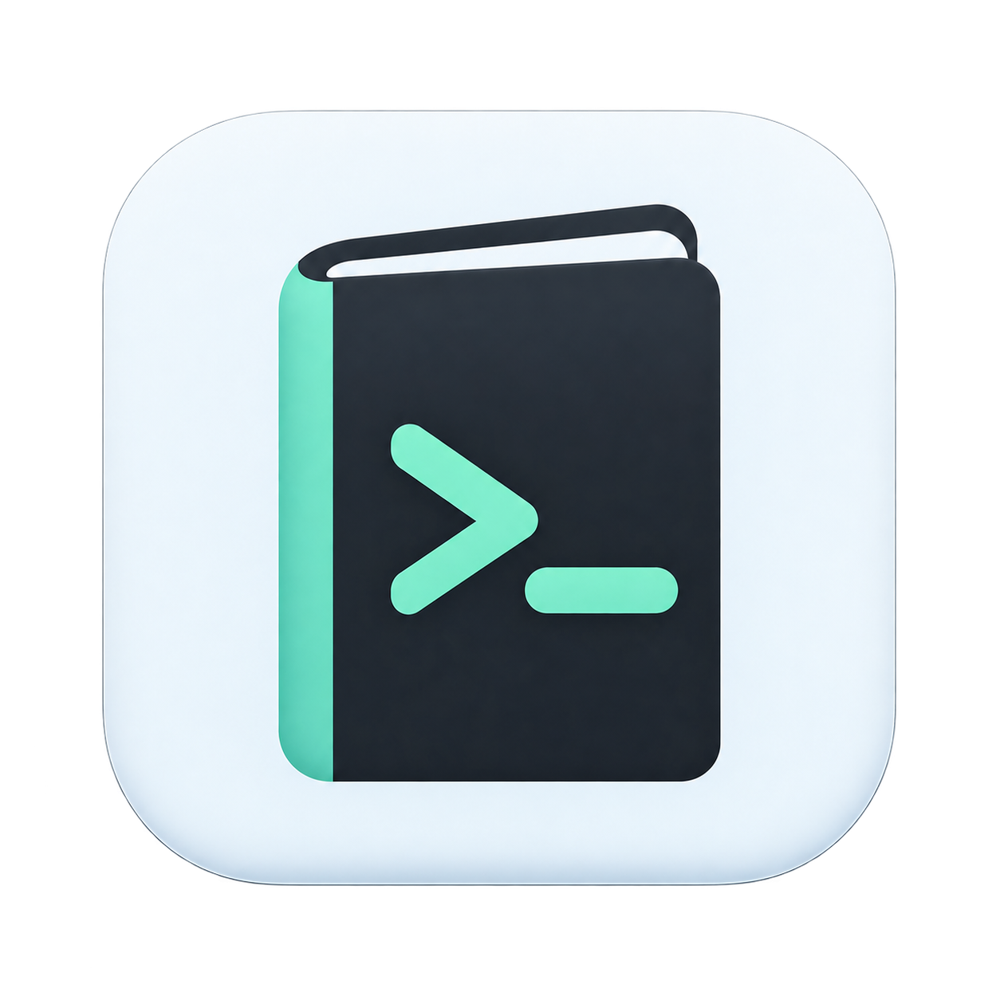

<p align="center">
  
</p>

<h1 align="center">Passport 사용자 매뉴얼</h1>

<p align="center">
  <strong>내 컴퓨터의 AI 작업과 서버 터미널을 한 화면에서.</strong><br />
  로컬 터미널·Claude Code·Codex·SSH·파일 전송을 함께 사용하는 데스크톱 앱입니다.
</p>

<p align="center">
  <a href="https://github.com/poyal/passport/releases/latest">최신 다운로드</a> ·
  <a href="#install">설치하기</a> ·
  <a href="docs/screenshots.md">화면 안내</a> ·
  <a href="https://github.com/poyal/passport/issues">문의·오류 신고</a>
</p>

**지원 환경:** macOS 14 이상·Apple Silicon, Windows 11·x64. Passport 자체 계정은 필요하지 않으며, SSH 서버와 AI 도구에는 각 서비스의 계정이 필요합니다. 호스트·설정·작업 배치는 내 컴퓨터에 저장하고 기기 간 이동에는 내보내기 파일을 사용합니다. 자동 동기화는 제공하지 않습니다.

처음 사용한다면 **설치 → 로컬 터미널 열기 → SSH 호스트 등록 → 작업 구성 저장 → 백업** 순서로 시작하세요.

[설치](#install) · [화면과 메뉴](#screens) · [로컬 터미널·AI](#local) · [터미널 CLI](#terminal-cli) · [SSH·분할](#ssh) · [탭 설정·연결 복구](#tabs) · [붙여넣기](#paste) · [파일 전송](#files) · [사용자 간 공유](#sharing) · [템플릿](#templates) · [알림·외형](#settings) · [백업](#backup) · [업데이트](#update) · [문제 해결](#faq)

<a id="install"></a>

## 설치

아래 플랫폼별 다운로드의 **Assets**에서 컴퓨터에 맞는 설치 파일을 선택하세요.

| 컴퓨터                                       | 선택할 파일                | 다운로드 안내                                                                      |
| -------------------------------------------- | -------------------------- | ---------------------------------------------------------------------------------- |
| Mac · Apple Silicon(M 시리즈), macOS 14 이상 | `Passport-…-mac-arm64.dmg` | [최신 릴리즈](https://github.com/poyal/passport/releases/latest)                   |
| Windows 11 · Intel / AMD(x64)                | `Passport-…-win-x64.exe`   | [Windows 최신 1.2.3](https://github.com/poyal/passport/releases/tag/v1.2.3)         |

Mac 최신 버전은 1.3.0, Windows 최신 버전은 1.2.3입니다. 1.3.0 릴리즈에는 Mac 설치 파일만 있으므로 Windows는 위의 전용 링크를 이용하세요. Intel Mac은 지원하지 않습니다. [플랫폼별 배포 상태와 변경 사항](docs/releases/README.md).

**메뉴가 보이지 않는 경우:** 아래의 공유함·탭 이름/아이콘/색상 설정·끊긴 연결 일괄 복구는 Mac 1.3.0부터 사용할 수 있습니다. Windows 1.2.3에는 아직 포함되지 않았습니다.

### Mac

1. **Mac ARM64 DMG**를 다운로드해 엽니다.
2. **Passport**를 **응용 프로그램(Applications)** 폴더로 옮깁니다.
3. Finder에서 설치 디스크를 추출하고 응용 프로그램 폴더의 Passport를 실행합니다.

현재 Mac 설치본은 ad-hoc 서명이며 Apple 공증을 포함하지 않습니다. 처음 실행할 때 개발자를 확인할 수 없거나 Apple에서 악성 소프트웨어 여부를 확인할 수 없다는 경고가 나올 수 있습니다. 아래 [Mac 최초 실행 경고](#mac-first-open)를 참고하세요.

### Windows

1. **Windows x64 EXE**를 다운로드해 실행합니다.
2. 설치 폴더를 선택하고 설치를 완료합니다.
3. 시작 메뉴에서 **Passport**를 실행합니다.

현재 로그인한 사용자에게 설치하며 관리자 권한을 요청하지 않습니다. Windows EXE에는 코드 서명이 없습니다.

<a id="mac-first-open"></a>

### Mac에서 개발자를 확인할 수 없다고 나올 때

1. [최신 공식 릴리즈](https://github.com/poyal/passport/releases/latest)에서 받은 Passport인지 확인합니다.
2. **응용 프로그램** 폴더의 Passport를 한 번 실행해 경고를 확인하고 닫습니다.
3. **시스템 설정 → 개인정보 보호 및 보안**을 열고 **보안** 영역까지 아래로 스크롤합니다.
4. Passport 실행이 차단되었다는 안내 옆의 **그래도 열기**를 누릅니다. 요청되면 Mac 로그인 암호 또는 Touch ID로 인증합니다.
5. 확인창에서 **열기**를 선택합니다. 이후에는 응용 프로그램 폴더에서 실행할 수 있습니다.

**그래도 열기**는 실행을 시도한 뒤 약 1시간 동안 표시됩니다. 보이지 않으면 Passport를 다시 실행한 뒤 설정을 확인하세요. [Apple의 최초 실행 안내](https://support.apple.com/ko-kr/guide/mac-help/mh40616/mac).

**컴퓨터를 손상시킵니다** 또는 **앱이 손상되었습니다**라는 경고는 이 절차와 다릅니다. 실행하지 말고 공식 설치 파일을 다시 받아 확인하세요. 계속되면 경고 문구와 함께 문의해 주세요. [Apple의 경고 유형 안내](https://support.apple.com/ko-kr/102445).

<a id="windows-first-open"></a>

### Windows에서 PC 보호·신뢰할 수 없음 경고가 나올 때

1. [Windows 공식 릴리즈](https://github.com/poyal/passport/releases/tag/v1.2.3)에서 받은 `Passport-…-win-x64.exe`인지 확인합니다.
2. 설치 파일을 실행할 때 **Windows의 PC 보호** 또는 인식할 수 없는 앱이라는 SmartScreen 경고가 표시되면 **추가 정보**를 누릅니다.
3. 앱 이름이 다운로드한 Passport 설치 파일인지 확인한 뒤 **실행**을 선택합니다. 영문 Windows에서는 **More info → Run anyway**입니다. 서명이 없어 게시자는 **알 수 없는 게시자**로 표시될 수 있습니다.
4. 설치를 마친 뒤 시작 메뉴에서 **Passport**를 실행합니다.

**실행** 버튼이 없거나 **스마트 앱 컨트롤**·조직 정책으로 차단된 경우에는 위 화면과 다릅니다. 보안 기능 전체를 끄지 말고 표시된 문구를 확인해 관리자 또는 [Passport 이슈](https://github.com/poyal/passport/issues)에 문의해 주세요. [Microsoft SmartScreen 안내](https://learn.microsoft.com/windows/security/operating-system-security/virus-and-threat-protection/microsoft-defender-smartscreen/).

<details>
<summary>다운로드 파일의 SHA-256 확인</summary>

설치 파일과 **같은 릴리즈**에서 `SHA256SUMS.txt`를 받으세요. 아래 결과를 체크섬 파일의 해당 설치 파일 줄과 비교합니다.

Mac 터미널:

```sh
cd ~/Downloads
shasum -a 256 Passport-*-mac-arm64.dmg
cat SHA256SUMS.txt
```

Windows PowerShell:

```powershell
cd ~/Downloads
Get-FileHash .\Passport-*-win-x64.exe -Algorithm SHA256
Get-Content .\SHA256SUMS.txt
```

</details>

<a id="screens"></a>

## 화면과 메뉴

| 위치           | 하는 일                                                   |
| -------------- | --------------------------------------------------------- |
| 사이드바 **+** | 내 컴퓨터의 로컬 터미널을 바로 엽니다.                    |
| **호스트**     | SSH·파일 서버를 등록하고 그룹·태그·즐겨찾기로 정리합니다. |
| **파일**       | 좌우 패널에서 로컬·서버 파일을 열고 전송합니다.           |
| **공유함**     | 받은 메시지·보내기·내 친구를 확인하고 등록·수신을 승인합니다. |
| **템플릿**     | 탭 하나의 터미널 구성과 분할 배치를 저장하고 다시 엽니다. |
| **설정**       | 셸·프로파일·외형·단축키·인증·백업·로그를 관리합니다.      |
| **벨 버튼**    | AI 알림을 확인하고 원래 터미널로 이동합니다.              |

[](docs/assets/workspace.png)

화면은 실제 앱과 촬영용 예제 데이터입니다. 재사용한 화면의 촬영 버전과 조건은 [화면 안내](docs/screenshots.md)에 기록합니다.

<a id="local"></a>

## 로컬 터미널과 AI 시작하기

1. 사이드바 **+** 또는 시작 화면의 **새 로컬 터미널**을 누릅니다. 설정한 기본 프로젝트 폴더에서 셸이 열리며, 지정하지 않았으면 홈 폴더를 사용합니다.
2. `cd`로 작업 폴더로 이동하고 설치한 `claude` 또는 `codex`를 실행합니다. AI 도구 설치와 로그인은 별도로 진행합니다.
3. 기본 환경을 바꾸려면 **설정 → 로컬 터미널**에서 셸·기본 프로젝트 폴더·시작 프로파일을 선택합니다. 변경 사항은 새 터미널부터 적용됩니다.
4. 프로젝트 기본값은 모든 탭에 공통으로 적용합니다. 특정 패널만 다르게 쓰려면 해당 패널의 **실행 환경 → 셸·폴더·프로파일 변경**에서 지정합니다.

Mac은 기본 로그인 셸·zsh·bash를 지원합니다. Windows는 별도 Git Bash 설치 없이 **Passport Bash**를 사용할 수 있고, **cmd·Windows PowerShell·PowerShell 7**도 선택할 수 있습니다.

Windows의 Passport Bash에서는 다음 `$` 프롬프트가 표시된 뒤 명령을 입력하세요. 이전 명령의 결과가 나왔어도 프롬프트가 준비되기 전에 빠르게 연속 입력하면 문자의 순서가 뒤섞일 수 있습니다.

Windows 1.2.0부터는 터미널 탭이나 패널을 닫으면 그 터미널에서 실행한 셸과 자식 프로그램도 종료합니다. 다른 터미널의 작업은 유지합니다.

| 동작                         | Mac | Windows                  |
| ---------------------------- | --- | ------------------------ |
| 현재 창에 새 로컬 터미널     | ⌘N  | Ctrl+N                   |
| 새 Passport 창과 로컬 터미널 | ⌘⇧N | Ctrl+Shift+N             |
| 터미널 붙여넣기              | ⌘V  | Ctrl+V                   |

새 창을 열어도 기존 연결은 유지됩니다. **설정 → 단축키**에서 바꿀 수 있으며 사용자 지정 키를 우선합니다.

<a id="terminal-cli"></a>

### CLI로 다른 로컬 터미널에 요청하기

Mac·Windows 1.2.3부터 사용할 수 있습니다. Passport 안의 스크립트·AI 도구에서 다른 창의 로컬 터미널에도 입력하고 화면을 읽을 수 있습니다. [플랫폼별 배포 상태](docs/releases/README.md)를 확인하세요.

1. **설정 → 로컬 터미널 → CLI 접근**에서 **조회·입력**을 선택합니다. 화면만 읽으려면 **조회만**을 선택합니다. 기본은 **끔**이며 선택하면 바로 저장됩니다.
2. 새 로컬 터미널을 열고 그 안에서 `passport identify`를 실행합니다. **내 패널 ID와 소속 탭 이름**이 표시됩니다. 설정을 바꾸면 기존 권한은 즉시 해제되므로 CLI를 실행할 터미널을 새로 여세요.
3. `passport list`로 대상 패널 ID를 찾습니다. 한 탭을 분할했다면 패널마다 ID가 다릅니다. 자동화에서는 `--json`을 붙여 결과를 읽을 수 있습니다.
4. 아래 `대상-ID`를 실제 ID로 바꿔 요청을 입력하고 결과를 읽습니다. `send`는 Enter를 추가하지 않습니다. 입력 내용을 확인한 뒤 `key ... enter`를 실행하세요.

```sh
passport send --pane 대상-ID "변경 내용을 검토해 주세요."
passport key --pane 대상-ID enter
passport read --pane 대상-ID --lines 20
```

위 명령은 Bash·zsh·PowerShell에서 같습니다. 긴 요청은 UTF-8 파일로 저장해 `passport send --pane 대상-ID --file request.txt`로 입력합니다. 입력과 Enter를 함께 보내려면 `--submit`을 붙입니다. 여러 줄은 대상 프로그램이 여러 줄 붙여넣기를 지원해야 하며, 미지원이면 입력하지 않고 오류를 반환합니다.

SSH 패널은 지원하지 않습니다. 읽기는 터미널에 남아 있는 화면 텍스트이며, 전송 성공은 AI 작업 완료를 뜻하지 않습니다. 전체 옵션, Bash·PowerShell 예제와 오류 해결은 [터미널 CLI 사용법](docs/terminal-cli.md)을 확인하세요.

<a id="ssh"></a>

## SSH 연결과 화면 나누기

1. **호스트 → 새 호스트**에서 이름·서버 주소·사용자 이름·포트를 입력하고 **호스트 저장**을 누릅니다. SSH 기본 포트는 22입니다.
2. 호스트를 두 번 클릭하거나 **SSH 연결**을 누릅니다. 저장한 인증이 없으면 비밀번호 또는 개인 키를 입력합니다.
3. 첫 연결에서는 서버 관리자가 제공한 SSH 지문과 비교해 승인합니다. 저장된 지문이 바뀌면 연결을 차단합니다.
4. 작업 탭의 **터미널 분할**로 다른 호스트를 추가하고 경계를 드래그해 크기를 조절합니다. **집중 보기 / 분할 복원**으로 한 패널을 크게 볼 수 있습니다.

호스트 목록은 그룹별로 접고 펼칠 수 있습니다. 그룹이 없는 호스트는 **미지정**에 모이며, 모두 그룹에 배정하면 미지정 항목은 사라집니다. 검색하면 일치하는 그룹이 펼쳐지고 검색을 지우면 기존 접힘 상태로 돌아갑니다.

[](docs/assets/hosts.png)

**설정 → 인증 프로필**에 계정을 저장하면 여러 호스트에서 재사용할 수 있습니다. **운영 도구**에서 작업 탭을 다른 Passport 창으로 옮길 때 연결과 이전 출력은 유지됩니다. 한 탭은 최대 16개, 전체 창을 합쳐 최대 32개 터미널을 지원합니다.

<a id="tabs"></a>

### 탭 이름·아이콘·색상 바꾸기

1. 바꿀 탭을 선택한 뒤 상단 **탭 설정**을 누릅니다. 왼쪽 탭을 우클릭해 **탭 편집**을 선택해도 됩니다.
2. 이름을 입력하고 OS 아이콘 타일 또는 기본 이모지를 고릅니다. **자동**은 첫 번째 패널의 아이콘을 사용하며, 로컬 패널은 터미널 아이콘으로 표시합니다.
3. 색상을 고른 뒤 **적용**을 누릅니다. 왼쪽 탭과 상단 작업 표시줄에 같은 색이 연하게 표시됩니다.

탭의 **+1**은 첫 패널 외에 패널이 한 개 더 있다는 뜻이고, **+2**는 두 개 더 있다는 뜻입니다. 작업 목록을 접어도 아이콘과 추가 개수는 보입니다. 탭 순서는 왼쪽 탭을 직접 드래그해 바꿉니다. 더블클릭은 편집 동작으로 사용하지 않습니다.

### 끊긴 연결을 한 번에 복구하기

1. 복구할 탭을 선택합니다.
2. 상단의 **연결 개수 바로 옆**에 나타나는 **끊긴 연결 복구** 아이콘을 누릅니다. 마우스를 올리면 복구할 개수를 확인할 수 있습니다.
3. 필요한 인증을 마치고 연결 개수가 갱신되는지 확인합니다. 모두 연결되면 복구 아이콘이 사라집니다.

정상 연결은 유지하고 끊긴 SSH·종료된 로컬 터미널만 다시 엽니다. 로컬 셸 안에서 직접 실행했던 `ssh`나 AI 명령은 자동으로 다시 실행하지 않습니다.

<a id="paste"></a>

## 파일과 이미지 붙여넣기

1. Finder·탐색기에서 파일이나 폴더를 선택해 복사합니다. Mac의 `.app`과 여러 항목도 지원합니다.
2. 입력할 로컬 터미널을 선택하고 Mac **⌘V**, Windows **Ctrl+V**를 누릅니다.
3. **전체 경로**가 입력됐는지 확인한 뒤 필요한 명령을 이어서 입력합니다. 공백·한글·작은따옴표가 있는 경로는 시작 셸에 맞게 처리하며 Enter를 자동으로 누르지 않습니다.

캡처한 **이미지 픽셀**을 복사한 경우에는 Passport 데이터 폴더에 PNG를 보관하고 그 경로를 입력합니다. 일반 텍스트로 복사한 파일 이름은 경로를 추측해서 바꾸지 않습니다. 여러 번 붙여넣으면 순서를 유지하며, 진행 중 탭을 바꿔도 원래 터미널에 입력합니다.

일반 텍스트는 여러 줄도 확인 창 없이 붙여넣습니다. 마지막 줄바꿈은 제거하고 별도 Enter를 추가하지 않습니다. 로컬 터미널에서 SSH에 접속한 경우도 같습니다. 대상 셸이 bracketed paste를 지원하지 않으면 중간 줄바꿈은 명령 실행으로 처리될 수 있습니다.

Claude Code·Codex 자체의 이미지 붙여넣기를 사용할 때는 Mac **Ctrl+V**, Windows **Alt+V**를 CLI에 전달합니다. 실제 첨부 표시와 이미지 해석은 해당 CLI의 지원 범위에 따릅니다.

**파일·폴더 드래그앤드롭:** Finder·탐색기에서 파일이나 폴더를 터미널 본문으로 끌어오세요. 이미지뿐 아니라 Markdown·PDF·압축 파일·확장자 없는 파일·빈 파일도 사용할 수 있습니다. 마우스 아래 패널의 테두리와 **이 터미널에 파일·폴더 경로 추가** 안내로 입력 대상을 확인한 뒤 놓습니다. 파일 복사·붙여넣기처럼 셸에 맞게 인용한 원본 경로를 현재 입력 위치에 추가하고, 기존 작성 내용은 유지합니다. 여러 항목도 자동 전송하지 않으므로 내용을 확인한 뒤 직접 Enter를 누르세요. **SSH 터미널에서는 파일·폴더 드래그앤드롭을 지원하지 않습니다.**

**SSH에서는 파일 전송으로 먼저 업로드한 뒤 원격 경로를 사용하세요.** 로컬 경로만 붙여서 파일을 업로드할 수는 없습니다. 터미널 안에서 다른 셸·SSH·WSL로 직접 전환한 상태까지 자동 판별하지 않습니다.

<a id="files"></a>

## 파일 전송하기

1. **파일** 화면의 좌우 패널에서 내 컴퓨터나 서버를 각각 선택하고 대상 폴더를 엽니다. 로컬·SFTP·FTP·명시적 FTPS를 사용할 수 있습니다.
2. 같은 이름이 있을 때의 처리 방식을 **건너뛰기 / 덮어쓰기 / 이름 변경**에서 선택합니다.
3. 파일·폴더를 반대편으로 드래그하거나 방향 버튼으로 복사합니다.
4. 아래 전송 목록에서 진행·완료·실패를 확인합니다. 연결이 끊겼다면 같은 호스트에 다시 연결한 뒤 재시도합니다.

양쪽 폴더를 모두 열어야 복사할 수 있습니다. 경로를 편집했다면 Enter로 이동을 마치고, 폴더를 읽는 동안에는 완료될 때까지 기다리세요.

[](docs/assets/files.png)

우클릭 메뉴에서 이름 변경·새 폴더·삭제를 사용할 수 있습니다. **삭제는 휴지통을 거치지 않습니다.** 앱을 종료하면 진행 중인 전송이 중단되고, 재시도는 처음부터 전송합니다.

<a id="sharing"></a>

## 등록한 친구와 메시지·파일 공유하기

공유는 기본으로 꺼져 있습니다. 양쪽에서 이 기능을 지원하는 Passport를 실행하고 같은 LAN 또는 사설 VPN에 연결하세요. IP를 아는 것만으로 등록되지는 않으며, 상대가 등록과 수신을 각각 승인해야 합니다.

### 1. 공유 켜기

1. 양쪽 앱에서 **설정 → 공유**를 엽니다.
2. **공유 사용**을 켜고 **사용할 네트워크**를 선택합니다.
3. **기본 다운로드 폴더 → 폴더 선택**에서 파일을 받을 폴더를 정합니다. 기본 위치는 내 다운로드 폴더의 `Passport`입니다.
4. **공유 설정 적용**을 누릅니다. 필요한 항목을 채우고 변경 사항이 있을 때 버튼이 활성화되며, 적용 후 **연결 주소**가 표시됩니다.

**주변 사용자 검색 및 내 기기 표시**는 선택 사항입니다. 검색되는 기기도 등록키와 승인이 필요합니다. 별도의 내 표시 이름은 입력하지 않으며, 친구를 등록할 때 각자 상대의 별칭을 정합니다.

### 2. 친구 등록하기

1. 한쪽 앱에서 **공유함 → 등록키 복사**를 누르고 상대에게 직접 또는 기존 메신저로 전달합니다.
2. 키를 받은 쪽은 **설정 → 공유**에서 **상대 별칭**과 **상대에게 받은 등록키**를 입력하고 **등록 요청 보내기**를 누릅니다.
3. 키를 만든 쪽은 **공유함**에 나타난 등록 요청에서 상대를 확인합니다. **상대 별칭**을 입력한 뒤 **사용자 등록 승인**을 누릅니다.
4. 양쪽의 **공유함 → 내 친구**에서 등록을 확인합니다. 목록을 다시 읽으려면 **친구 목록 불러오기**를 누릅니다.

별칭은 내 앱에서만 사용합니다. 같은 친구도 내 앱에서는 “승민”, 상대 앱에서는 다른 이름으로 보일 수 있습니다. **내 친구 → 친구 관리**에서 별칭·연결 주소를 바꾸거나 차단·등록 해제를 할 수 있습니다. 등록키는 생성 후 5분 동안 한 기기에만 사용할 수 있으므로, 만료됐다면 새 키를 전달하세요.

### 3. 보내고 받기

1. **공유함 → 내 친구**에서 상대의 **보내기**를 누릅니다. 해당 친구가 선택된 **보내기** 탭으로 이동합니다.
2. **Markdown 메시지**를 입력하고 **메시지 보내기**를 누르거나, **파일 보내기**에서 파일 하나를 고릅니다.
3. 받는 사람은 공유함에 표시된 상대·내용 종류·크기를 확인합니다. **메시지 받기** 또는 **승인하고 저장**을 누르면 본문을 받고, 원하지 않으면 **거절**합니다.
4. 보내는 사람은 완료 안내를 확인합니다. 요청을 보낸 것만으로 전달이 완료된 것은 아닙니다. 수신 요청은 10분 후 만료됩니다.

공유함은 **받은 메시지** 탭부터 열립니다. 보내기 탭으로 옮겼다가 돌아와도 작성 중인 메시지는 유지됩니다.

| 받은 자료 | 저장·확인 방법 |
| --- | --- |
| 메시지 | **받은 메시지** 목록을 눌러 Markdown으로 읽습니다. **전체 Markdown 복사** 또는 코드 블록의 **코드 복사**로 클립보드에 복사합니다. |
| 파일 | 설정한 다운로드 폴더에 저장됩니다. 같은 이름이 있으면 `(1)`, `(2)`를 붙여 기존 파일을 보존합니다. |

메시지·파일·승인 응답은 기기 사이에서 암호화합니다. 메시지의 링크를 열거나 외부 이미지를 불러오지 않으며, 파일을 실행·미리보기·압축 해제하거나 터미널에 자동 입력하지 않습니다. 첨부한 `.md`도 파일로 저장합니다. 파일은 최대 100 MiB, 메시지는 UTF-8 256 KiB까지입니다. [허용 확장자와 상세 공유 안내](docs/sharing.md#보내기와-수신-승인)를 확인하세요.

**설정 → 공유 → 메시지 자동 정리**에서 **자동 정리 안 함** 또는 **1–30일 후**를 고르고 **공유 설정 적용**을 누릅니다. 기본은 **7일 후**이며 기존 메시지에도 적용됩니다. 메시지를 정리하거나 삭제해도 다운로드 파일은 지우지 않습니다.

### AI와 CLI에서 친구에게 보내기

공유를 켠 뒤 **새 로컬 터미널**에서 실행합니다. 공유 CLI는 **CLI 접근 → 조회·입력**을 별도로 켤 필요가 없습니다.

```sh
# 먼저 등록된 친구의 별칭·기기 ID·차단 여부를 확인합니다.
passport share friends
passport share friends --json

# 실제 등록한 별칭과 보내려는 파일을 지정합니다.
passport share send --to "승민" --file "./문서.pdf"
passport share send --to "승민" --text "# 작업 결과"

# send 결과의 ID로 수신 상태를 확인하거나 요청을 취소합니다.
passport share status 전송-ID --json
passport share cancel 전송-ID --json
```

같은 별칭이 여럿이면 `--to`에 기기 ID를 지정합니다. `pending`은 상대 승인 대기이고 `delivered`가 전달 완료입니다. 실패하거나 응답을 확인하지 못했다면 자동으로 다시 보내지 말고 상대의 수신 여부를 먼저 확인하세요.

AI에게 “친구 목록을 확인하고 승민에게 이 문서를 보내 주세요”라고 요청할 수 있습니다. 등록·수신 승인과 받은 메시지 읽기는 앱 화면에서만 가능하며, 받은 내용을 AI에 자동 전달하지 않습니다. Markdown 파일·표준입력 예제는 [공유 CLI 사용법](docs/sharing.md#ai와-cli-사용)을 확인하세요.

<a id="templates"></a>

## 자주 쓰는 작업 구성 저장하기

1. 저장할 탭 안에 로컬·SSH 패널을 배치하고 분할 크기를 조절합니다.
2. 상단의 **템플릿 저장 아이콘**을 누르고 이름을 입력해 저장합니다.
3. **템플릿** 화면에서 카드를 누르면 같은 구성으로 새 탭을 열고 연결합니다. 폴더 아이콘의 **배치만 열기**는 연결하지 않고 화면만 준비합니다.

템플릿에는 **탭 하나**의 이름·아이콘·색상·셸·폴더·프로파일·분할 배치가 들어갑니다. 실행 중인 프로세스나 AI 대화는 저장하지 않습니다. 열린 탭과 분할 배치는 별도로 자동 보관하며 앱을 다시 열면 서버 연결은 직접 시작합니다.

<a id="settings"></a>

## 알림·외형·작업 도구 설정하기

**AI 알림:** **설정 → 로컬 터미널**에서 **AI 작업 알림** 프로파일과 Claude/Codex 연동을 선택한 뒤 새 터미널을 엽니다. 벨 버튼에서 알림을 누르면 원래 터미널로 이동합니다. 활성 창에서 해당 터미널을 보면 그 터미널의 미읽음만 지우고 기록·다른 터미널의 알림·승인 대기는 유지합니다. 승인·질문 응답이 필요할 때, 응답이 끝났을 때, 작업 중단이 확인됐을 때 알립니다. 시작·진행률·같은 요청의 반복 신호는 제외합니다. 알림을 읽어도 확인된 승인·답변 대기 상태는 처리 신호가 올 때까지 유지됩니다. CLI가 정확한 대기 상태를 제공하지 않으면 일반 확인 알림으로 표시합니다.

OS 배너 조건은 **설정 → AI 작업 알림**에서 조절합니다. 새 기본값은 **해당 터미널을 보고 있지 않을 때**이며, 기존에 저장한 표시 조건은 유지합니다. **응답 내용 포함**을 켜면 이후 완료 알림에 마지막 응답을 최대 200자 저장합니다. OS 배너에 내용도 보려면 **데스크톱 알림 설명 표시**를 함께 켜세요. 두 항목은 기본 꺼짐입니다.

**글꼴과 외형:** **설정 → 외형 → 터미널 설정**에서 글꼴을 검색하고 한글·표 미리보기를 확인해 선택합니다. 설치 글꼴과 내장 7종(JetBrains Mono, Cascadia Mono/Code, Fira Code, Source Code Pro, IBM Plex Mono, D2Coding)을 사용할 수 있습니다. 라이트·다크, 테마, 커서와 파일 색상도 조절할 수 있습니다.

**단축키:** **설정 → 단축키**에는 현재 OS의 설정만 표시되며 Windows와 macOS 설정은 따로 저장합니다. 아래 편집 방법은 1.2.1부터 적용됩니다.

1. 기능 옆의 **키 변경**을 누릅니다. 한 기능에 키 하나를 지정합니다.
2. 사용할 키를 함께 누른 뒤 **적용**을 누릅니다. 겹치는 키는 충돌하는 기능 이름을 확인해 조정합니다.
3. **X**로 해제하면 해당 기능의 단축키를 사용하지 않습니다. **초기화**는 해당 기능의 기본 키를, **전체 초기화**는 현재 OS의 기본 키 전체를 복원합니다.
4. **단축키 저장**을 눌러 적용합니다. **변경 취소**는 저장하지 않은 변경을 되돌립니다.

이전에 한 기능에 여러 키를 지정했다면 첫 번째 키만 유지합니다. 기존 백업을 가져올 때도 같으며, 해제한 기능은 해제 상태로 유지합니다.

**줄바꿈:** 터미널에서 **Shift+Enter**를 누르면 CLI에 줄바꿈용 키를 전달합니다. **설정 → 단축키 → 터미널 → 줄바꿈**에서 변경·해제할 수 있습니다. 일반 **Enter**는 기존 동작을 유지하며, 줄바꿈을 변경·해제한 뒤 원래 Shift+Enter를 누르면 전송하지 않습니다. 검색창·설정 입력란에는 적용하지 않으며, 실제 줄바꿈 처리는 실행 중인 CLI의 지원과 키 설정에 따릅니다.

Windows의 기본 **Ctrl+C**는 선택한 텍스트를 복사하며, 선택이 없으면 아무 동작도 하지 않습니다. 실행 중인 명령을 중단하려면 **Ctrl+Shift+C**를 사용합니다. Mac은 **⌘C**로 복사하고 **Ctrl+C**로 중단합니다. 두 기능 모두 키를 바꿀 수 있으며, 입력칸 편집과 Esc·Tab·방향키 화면 조작은 유지됩니다.

**검색과 로그:** 터미널의 **검색** 아이콘에서 문자를 입력하고 Enter·Shift+Enter로 결과를 이동합니다. **설정 → 세션 로그**에서 기록·보관 조건과 로그 조회·내보내기를 사용합니다. 로그에는 터미널에 출력된 내용이 저장됩니다.

**스니펫과 터널:** **스니펫 → 새 스니펫**에서 자주 쓰는 명령을 저장합니다. **명령 실행**은 Enter까지 전달하므로 대상과 내용을 확인하세요. SSH 터널은 **설정 → 포트 포워딩**에서 규칙을 저장하고 직접 시작합니다.

<a id="backup"></a>

## 백업과 기기 변경하기

1. **설정 → 내보내기와 백업 → 내보내기**를 엽니다. 호스트·그룹·스니펫·템플릿·작업 배치·설정을 함께 저장합니다.
2. 비밀번호·개인 키를 포함하려면 해당 옵션을 켜고 **10자 이상의 별도 암호**를 지정합니다. 기본값은 인증 정보 제외입니다.
3. **내보내기**를 눌러 파일을 저장하고 암호는 별도로 보관합니다.
4. 다른 컴퓨터에서 **가져오기 → 파일 선택 · 미리보기**를 누릅니다. 암호화된 파일이면 암호를 입력하고 미리보기를 확인한 뒤 **가져오기 적용**을 누릅니다.

**자동 백업** 탭에서 최근 일별 백업도 확인할 수 있습니다. 내보내기에는 실행 중인 연결·터널, 세션 로그 파일과 명령 이력, 공유 기기키·등록 상대·메시지가 포함되지 않습니다. 다른 컴퓨터의 셸·글꼴·로컬 폴더는 다시 확인하세요. [상세 백업 안내](docs/user-guide.md#설정-내보내기가져오기와-백업).

<a id="update"></a>

## 업데이트하기

1. **설정 → About → 업데이트 확인**을 누릅니다. 앱 시작 때에도 새 공개 버전을 확인합니다.
2. **변경 내역 보기**로 내용을 확인하고 **설치 파일 다운로드**로 현재 OS에 맞는 파일을 받습니다. 해당 플랫폼의 파일이 아직 없으면 변경 내역만 표시합니다.
3. 작업을 마친 뒤 Passport를 완전히 종료합니다. Mac은 **⌘Q**를 사용합니다.
4. Mac은 새 DMG의 앱을 응용 프로그램 폴더로 옮겨 **대치**하고, Windows는 새 EXE를 실행합니다.

호스트·인증·설정·작업 배치는 앱 설치 파일과 별도로 보관해 유지됩니다. 업데이트 후 연결은 직접 다시 시작하세요. 앱 내부 자동 설치·재시작은 제공하지 않습니다.

<a id="faq"></a>

## 자주 확인하는 내용

| 상황                                        | 확인할 내용                                                                                                         |
| ------------------------------------------- | ------------------------------------------------------------------------------------------------------------------- |
| Mac 최초 실행 시 개발자를 확인할 수 없음     | 공식 다운로드인지 확인한 뒤 **시스템 설정 → 개인정보 보호 및 보안 → 그래도 열기**를 선택하세요. [단계별 안내](#mac-first-open). |
| Windows 설치 시 PC 보호·신뢰할 수 없음 경고 | 공식 다운로드인지 확인한 뒤 SmartScreen의 **추가 정보 → 실행**을 선택하세요. 버튼이 없는 경우도 [단계별 안내](#windows-first-open)를 확인하세요. |
| Mac에서 **Passport Safe Storage** 암호 요청 | 서버 암호가 아닌 **로그인 키체인 암호**입니다. 신뢰하는 앱에 **항상 허용**을 선택하면 반복 요청을 줄일 수 있습니다. |
| 새 테스트 앱을 열어도 이전 앱이 보임        | 실행 중인 Passport를 ⌘Q로 완전히 종료한 뒤 새 앱을 여세요.                                                          |
| 서버 연결·인증 실패                         | 주소·포트·계정·네트워크와 선택한 인증 프로필을 확인하세요.                                                          |
| 붙여넣기에 파일 이름만 보임                 | 파일 이름 텍스트가 아니라 Finder·탐색기의 항목 자체를 복사했는지 확인하세요.                                        |
| AI 알림이 오지 않음                         | 연동·프로파일 적용 후 새 터미널을 열었는지, OS 알림 허용·방해 금지·앱 표시 조건을 확인하세요.                       |
| 파일 전송 실패                              | 대상의 쓰기 권한·남은 공간·연결 상태를 확인하고 전송 목록에서 재시도하세요.                                         |
| 공유 설정 적용 버튼이 비활성화됨 | 네트워크·다운로드 폴더를 모두 선택했는지 확인하세요. 저장된 값과 같으면 다시 적용할 필요가 없습니다. |
| 친구가 목록에 없거나 보낼 수 없음 | 양쪽 공유 설정과 등록 승인을 확인하세요. **내 친구 → 친구 목록 불러오기**로 갱신하고 차단 여부·연결 주소도 확인하세요. |
| `passport share`의 접근 권한 오류 | 공유를 켠 뒤 새 로컬 터미널을 여세요. 공유를 껐다 켜면 이전 터미널의 권한은 복구되지 않습니다. |
| 공유 파일이 저장되지 않음 | 수신 승인·저장 폴더 권한·남은 공간·연결을 확인하세요. OS 파일 보호가 실패한 경우에는 저장하지 않습니다. |
| 업데이트 다운로드 버튼이 없음               | 해당 OS·칩의 새 설치 파일이 아직 공개되지 않았을 수 있습니다. [릴리즈 목록](docs/releases/README.md)을 확인하세요.  |

문제를 신고할 때 **설정 → About**의 Passport 버전, 운영체제·칩 종류, 재현 순서와 오류 문구를 함께 남겨 주세요. 화면의 비밀번호·개인 키·서버 주소·공유 등록키·메시지 내용은 가려 주세요.

## 문서와 문의

- [상세 사용 안내](docs/user-guide.md) · [로컬 AI·셸·프로파일 안내](docs/local-ai-workspaces.md) · [전체 화면과 촬영 조건](docs/screenshots.md).
- [릴리즈 노트](docs/releases/README.md) · [개발 안내](docs/development.md) · [검증 기록](docs/verification.md).
- [로컬 검증 후 배포](docs/local-release-guide.md) · [Windows 검증·릴리즈 인계](docs/windows-paste-release.md) · [배포·산출물 보관](docs/distribution.md).
- [전체 문서](docs/README.md) · [오픈소스 고지](THIRD_PARTY_NOTICES.md).

제작자 **Poyal** · [poyal.work@gmail.com](mailto:poyal.work@gmail.com) · [GitHub](https://github.com/poyal/passport) · [문의·오류 신고](https://github.com/poyal/passport/issues)
