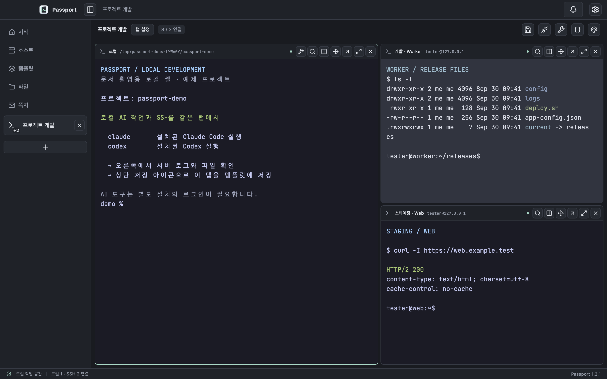
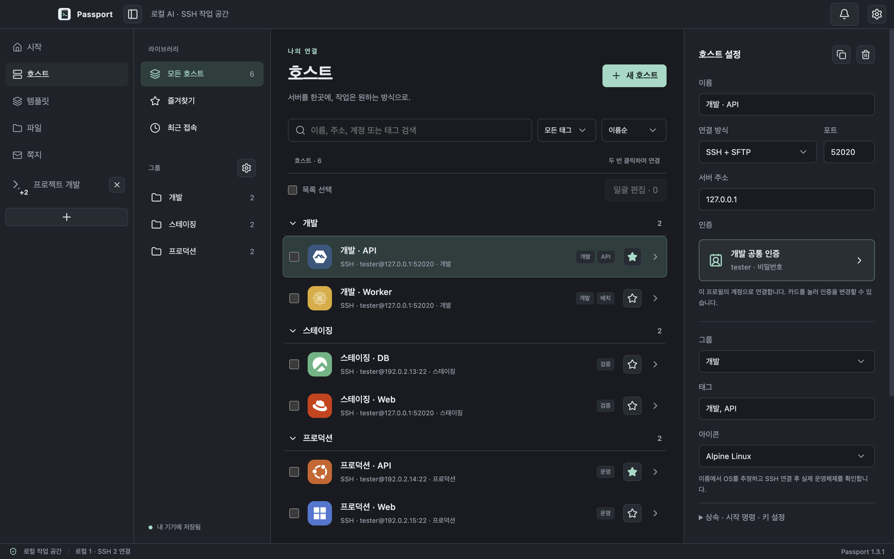
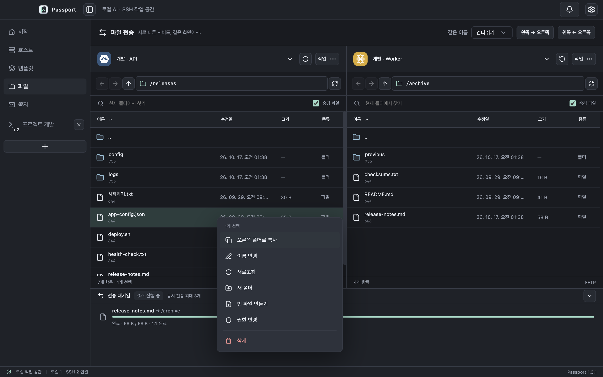
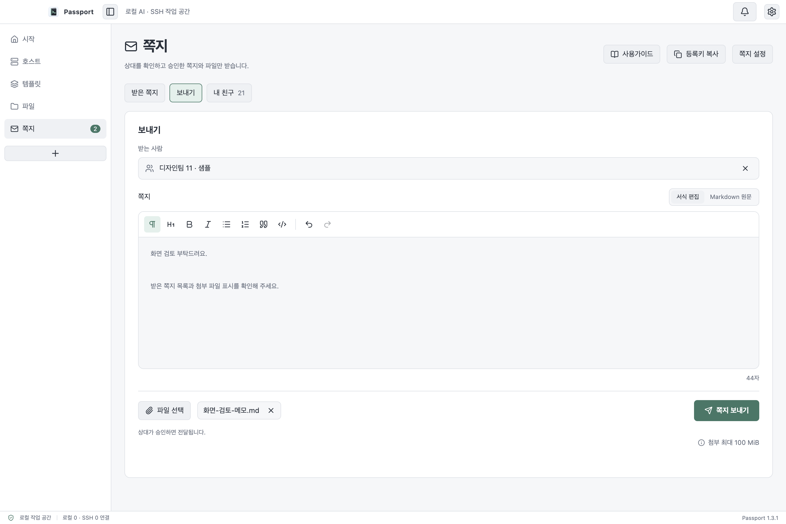
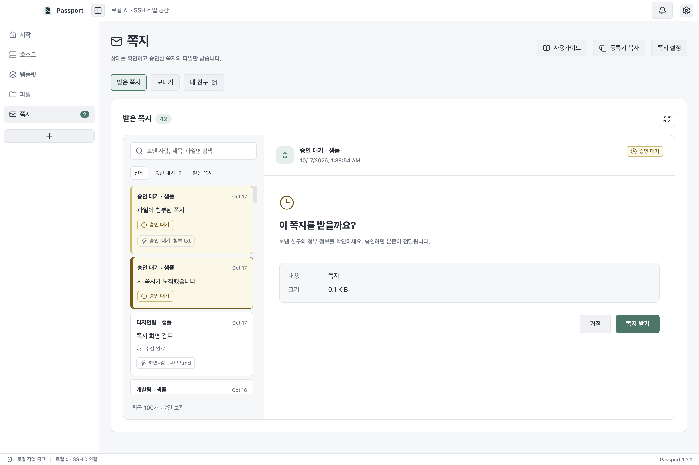

<p align="center">
  
</p>

<h1 align="center">Passport 사용자 매뉴얼</h1>

<p align="center">
  <strong>내 컴퓨터의 AI 작업과 서버 터미널을 한 화면에서.</strong><br />
  로컬 터미널·Claude Code·Codex·SSH·파일 전송을 함께 사용하는 데스크톱 앱입니다.
</p>

<p align="center">
  <a href="https://github.com/poyal/passport/releases/latest">최신 다운로드</a> ·
  <a href="#install">설치하기</a> ·
  <a href="#screens">화면 안내</a> ·
  <a href="https://github.com/poyal/passport/issues">문의·오류 신고</a>
</p>

**지원 환경:** macOS 14 이상·Apple Silicon, Windows 11·x64. Passport 자체 계정은 필요하지 않으며, SSH 서버와 AI 도구에는 각 서비스의 계정이 필요합니다. 호스트·설정·작업 배치는 내 컴퓨터에 저장하고 기기 간 이동에는 내보내기 파일을 사용합니다. 자동 동기화는 제공하지 않습니다.

처음 사용한다면 **설치 → 로컬 터미널 열기 → SSH 호스트 등록 → 작업 구성 저장 → 백업** 순서로 시작하세요.

[설치](#install) · [화면과 메뉴](#screens) · [로컬 터미널·AI](#local) · [터미널 CLI](#terminal-cli) · [SSH·분할](#ssh) · [탭 설정·연결 복구](#tabs) · [붙여넣기](#paste) · [파일 전송](#files) · [친구와 쪽지 주고받기](#sharing) · [템플릿](#templates) · [알림·외형](#settings) · [백업](#backup) · [업데이트](#update) · [문제 해결](#faq)

<a id="install"></a>

## 설치

아래 플랫폼별 다운로드의 **Assets**에서 컴퓨터에 맞는 설치 파일을 선택하세요.

| 컴퓨터                                       | 선택할 파일                | 다운로드 안내                                                                      |
| -------------------------------------------- | -------------------------- | ---------------------------------------------------------------------------------- |
| Mac · Apple Silicon(M 시리즈), macOS 14 이상 | `Passport-…-mac-arm64.dmg` | [Mac 1.3.4](https://github.com/poyal/passport/releases/tag/v1.3.4)                   |
| Windows 11 · Intel / AMD(x64)                | `Passport-…-win-x64.exe`   | [Windows 1.3.3](https://github.com/poyal/passport/releases/tag/v1.3.3) |

현재 공개 설치본은 **Mac 1.3.4 · Windows 1.3.3**입니다. 이 매뉴얼은 Mac 1.3.4 기준이며, 이전 세션 복원·로그 묶음·터미널 쪽지 메뉴는 Windows 배포 전입니다. Intel Mac은 지원하지 않습니다. [플랫폼별 배포 상태와 변경 사항](https://github.com/poyal/passport/releases).

**그룹미설정** 필터·AI 자동 탭 아이콘·템플릿 구성 태그는 현재 개발 소스에 반영되어 있으며, 위 공개 설치본에는 아직 포함되지 않습니다.

**메뉴가 보이지 않는 경우:** 최신 버전으로 업데이트하세요. 쪽지 편집기·첨부·승인 대기 필터는 양쪽 PC 모두 1.3.1 이상에서 사용합니다.

쪽지 CLI의 수신 목록·승인·읽기와 오류 알림 닫기는 **Mac·Windows 1.3.3**에서 사용합니다. macOS zsh 문자 폭 호환 모드는 Mac 1.3.3에 포함됩니다.

### Mac

1. **Mac ARM64 DMG**를 다운로드해 엽니다.
2. **Passport**를 **응용 프로그램(Applications)** 폴더로 옮깁니다.
3. Finder에서 설치 디스크를 추출하고 응용 프로그램 폴더의 Passport를 실행합니다.

현재 Mac 설치본은 ad-hoc 서명이며 Apple 공증을 포함하지 않습니다. 처음 실행할 때 개발자를 확인할 수 없거나 Apple에서 악성 소프트웨어 여부를 확인할 수 없다는 경고가 나올 수 있습니다. 아래 [Mac 최초 실행 경고](#mac-first-open)를 참고하세요.

### Windows

1. **Windows x64 EXE**를 다운로드해 실행합니다.
2. 설치 폴더를 선택하고 설치를 완료합니다.
3. 시작 메뉴에서 **Passport**를 실행합니다.

현재 로그인한 사용자에게 설치하며 관리자 권한을 요청하지 않습니다. Windows EXE에는 코드 서명이 없습니다.

<a id="mac-first-open"></a>

### Mac에서 개발자를 확인할 수 없다고 나올 때

1. [최신 공식 릴리즈](https://github.com/poyal/passport/releases/latest)에서 받은 Passport인지 확인합니다.
2. **응용 프로그램** 폴더의 Passport를 한 번 실행해 경고를 확인하고 닫습니다.
3. **시스템 설정 → 개인정보 보호 및 보안**을 열고 **보안** 영역까지 아래로 스크롤합니다.
4. Passport 실행이 차단되었다는 안내 옆의 **그래도 열기**를 누릅니다. 요청되면 Mac 로그인 암호 또는 Touch ID로 인증합니다.
5. 확인창에서 **열기**를 선택합니다. 이후에는 응용 프로그램 폴더에서 실행할 수 있습니다.

**그래도 열기**는 실행을 시도한 뒤 약 1시간 동안 표시됩니다. 보이지 않으면 Passport를 다시 실행한 뒤 설정을 확인하세요. [Apple의 최초 실행 안내](https://support.apple.com/ko-kr/guide/mac-help/mh40616/mac).

**컴퓨터를 손상시킵니다** 또는 **앱이 손상되었습니다**라는 경고는 이 절차와 다릅니다. 실행하지 말고 공식 설치 파일을 다시 받아 확인하세요. 계속되면 경고 문구와 함께 문의해 주세요. [Apple의 경고 유형 안내](https://support.apple.com/ko-kr/102445).

<a id="windows-first-open"></a>

### Windows에서 PC 보호·신뢰할 수 없음 경고가 나올 때

1. [Windows 공식 릴리즈](https://github.com/poyal/passport/releases/tag/v1.3.3)에서 받은 `Passport-…-win-x64.exe`인지 확인합니다.
2. 설치 파일을 실행할 때 **Windows의 PC 보호** 또는 인식할 수 없는 앱이라는 SmartScreen 경고가 표시되면 **추가 정보**를 누릅니다.
3. 앱 이름이 다운로드한 Passport 설치 파일인지 확인한 뒤 **실행**을 선택합니다. 영문 Windows에서는 **More info → Run anyway**입니다. 서명이 없어 게시자는 **알 수 없는 게시자**로 표시될 수 있습니다.
4. 설치를 마친 뒤 시작 메뉴에서 **Passport**를 실행합니다.

**실행** 버튼이 없거나 **스마트 앱 컨트롤**·조직 정책으로 차단된 경우에는 위 화면과 다릅니다. 보안 기능 전체를 끄지 말고 표시된 문구를 확인해 관리자 또는 [Passport 이슈](https://github.com/poyal/passport/issues)에 문의해 주세요. [Microsoft SmartScreen 안내](https://learn.microsoft.com/windows/security/operating-system-security/virus-and-threat-protection/microsoft-defender-smartscreen/).

<details>
<summary>다운로드 파일의 SHA-256 확인</summary>

설치 파일과 **같은 릴리즈**에서 `SHA256SUMS.txt`를 받으세요. 아래 결과를 체크섬 파일의 해당 설치 파일 줄과 비교합니다.

Mac 터미널:

```sh
cd ~/Downloads
shasum -a 256 Passport-*-mac-arm64.dmg
cat SHA256SUMS.txt
```

Windows PowerShell:

```powershell
cd ~/Downloads
Get-FileHash .\Passport-*-win-x64.exe -Algorithm SHA256
Get-Content .\SHA256SUMS.txt
```

</details>

<a id="screens"></a>

## 화면과 메뉴

| 위치           | 하는 일                                                   |
| -------------- | --------------------------------------------------------- |
| 사이드바 **+** | 내 컴퓨터의 로컬 터미널을 바로 엽니다.                    |
| **호스트**     | SSH·파일 서버를 등록하고 그룹·태그·즐겨찾기로 정리합니다. |
| **파일**       | 좌우 패널에서 로컬·서버 파일을 열고 전송합니다.           |
| **쪽지**     | 받은 쪽지·보내기·내 친구를 확인하고 등록·수신을 승인합니다. |
| **템플릿**     | 탭 하나의 터미널 구성과 분할 배치를 저장하고 다시 엽니다. |
| **설정**       | 셸·프로파일·외형·단축키·인증·백업·로그를 관리합니다.      |
| **벨 버튼**    | AI 알림을 확인하고 원래 터미널로 이동합니다.              |

[](docs/assets/workspace.png)

아래 전체 화면은 1.3.1 최종 Mac 앱에서 촬영한 실제 화면입니다. 예제 서버·친구·쪽지·파일만 사용했으며 실제 사용자 데이터나 AI 응답을 촬영한 것이 아닙니다. 변경되지 않은 화면은 재사용합니다.

<a id="local"></a>

## 로컬 터미널과 AI 시작하기

1. 사이드바 **+** 또는 시작 화면의 **새 로컬 터미널**을 누릅니다. 설정한 기본 프로젝트 폴더에서 셸이 열리며, 지정하지 않았으면 홈 폴더를 사용합니다.
2. `cd`로 작업 폴더로 이동하고 설치한 `claude` 또는 `codex`를 실행합니다. AI 도구 설치와 로그인은 별도로 진행합니다.
3. 기본 환경을 바꾸려면 **설정 → 로컬 터미널**에서 셸·기본 프로젝트 폴더·시작 프로파일을 선택합니다. 변경 사항은 새 터미널부터 적용됩니다.
4. 프로젝트 기본값은 모든 탭에 공통으로 적용합니다. 특정 패널만 다르게 쓰려면 해당 패널의 **실행 환경 → 셸·폴더·프로파일 변경**에서 지정합니다.

Mac은 기본 로그인 셸·zsh·bash를 지원합니다. Windows는 별도 Git Bash 설치 없이 **Passport Bash**를 사용할 수 있고, **cmd·Windows PowerShell·PowerShell 7**도 선택할 수 있습니다.

Windows의 Passport Bash에서는 다음 `$` 프롬프트가 표시된 뒤 명령을 입력하세요. 이전 명령의 결과가 나왔어도 프롬프트가 준비되기 전에 빠르게 연속 입력하면 문자의 순서가 뒤섞일 수 있습니다.

Windows 1.2.0부터는 터미널 탭이나 패널을 닫으면 그 터미널에서 실행한 셸과 자식 프로그램도 종료합니다. 다른 터미널의 작업은 유지합니다.

| 동작                         | Mac | Windows                  |
| ---------------------------- | --- | ------------------------ |
| 현재 창에 새 로컬 터미널     | ⌘N  | Ctrl+N                   |
| 새 Passport 창과 로컬 터미널 | ⌘⇧N | Ctrl+Shift+N             |
| 터미널 붙여넣기              | ⌘V  | Ctrl+V                   |

새 창을 열어도 기존 연결은 유지됩니다. **설정 → 단축키**에서 바꿀 수 있으며 사용자 지정 키를 우선합니다.

### 셸과 시작 프로파일

로컬 터미널은 `TERM=xterm-256color`, `COLORTERM=truecolor`를 전달합니다. 앱을 실행한 환경의 `NO_COLOR`, `FORCE_COLOR`, `CLICOLOR`, `CLICOLOR_FORCE`는 새 셸에 상속하지 않아 빌드 도구·IDE에서 앱을 시작해도 CLI 색상이 꺼지지 않습니다. 사용자가 셸 시작 파일이나 시작 프로파일에서 지정한 값은 이후 적용됩니다. CLI의 RGB·256색 출력은 그대로 표시하고, 기본 글자·배경과 ANSI 기본 16색은 선택한 터미널 테마를 따릅니다. [NO_COLOR 동작 규약](https://no-color.org/).

**설정 → 로컬 터미널**에서 기본값과 사용자 프로파일을 관리합니다. 여러 프로파일의 순서를 바꾸고 각 항목의 내용을 펼쳐 볼 수 있습니다. 현재 지원 항목은 명령과 인자를 분리한 단축 명령, 환경 변수, PATH 앞/뒤 추가입니다. 기본은 기존 값 보존이며, 항목별로 덮어쓰기를 선택할 수 있습니다. 예약 환경 변수는 직접 변경할 수 없습니다. 일반 설정에 저장되는 환경 변수에는 비밀번호·토큰을 넣지 마세요.

| OS      | 셸                                                              |
| ------- | --------------------------------------------------------------- |
| macOS   | 계정 기본 셸, zsh, bash                                         |
| Windows | Passport Bash, cmd, Windows PowerShell 5.1, 설치된 PowerShell 7 |

Windows의 새 사용자 기본값은 **Passport Bash + Unix 단축명령**입니다. 공식 Portable Git의 셸·Unix 도구를 앱 리소스에 포함하므로 외부 Git Bash나 WSL 설치를 요구하지 않습니다. `sh`는 실제 셸이며 `ll`은 단축 명령입니다. cmd·PowerShell은 원래 문법을 사용합니다. PowerShell 두 버전은 독립 선택이며, 없는 셸로 자동 대체하지 않습니다.

시작 프로파일·AI 자동 실행·이전 세션 복원을 모두 끈 일반 터미널은 원래 셸의 시작 인자로 엽니다. 이 중 하나를 사용하면 앱 전용 로더를 사용합니다. zsh는 사용자 `ZDOTDIR`과 시작 파일 순서를 이어 읽고 원래 경로를 복구합니다. Bash 로더는 `/etc/profile` 다음 첫 사용자 로그인 파일을 읽는 대화형 초기화 방식이며, Bash의 `login_shell` 플래그를 바꾸지는 않습니다. 따라서 **추가 프로파일·AI 자동 실행·이전 세션 복원 중 하나를 켠 Bash에서는 `.bash_logout`을 자동으로 읽지 않습니다.** 사용자 EXIT trap은 그대로 유지합니다. 그 종료 동작이 필요한 구성은 세 기능을 끈 Bash를 선택하세요.

PowerShell 로더는 실행 정책을 우회하지 않습니다. 정책·사용자 프로파일 오류가 있으면 해당 터미널에 오류가 보이고 적용 실패로 표시합니다. cmd 단축 명령은 `doskey`를 사용하므로 대화형 전용입니다. cmd는 UNC 시작 폴더와 큰따옴표가 포함된 추가 프로파일 값을 거절합니다. 이런 경로나 값은 PowerShell 또는 Passport Bash에서 사용할 수 있습니다.

패널의 **실행 환경**에서 실제 실행 파일, 폴더, 프로파일 버전, 적용·충돌 생략 결과와 CLI 경로·버전 진단을 확인합니다. 변경은 새 세션부터 적용됩니다. 로컬 자동 로그는 기본적으로 꺼져 있으며 SSH 자동 로그 설정과 별도로 관리합니다.

### 복합문자 폭 호환

로컬 터미널 선택 창의 **문자 폭**에서 **기본(Unicode 11)** 또는 **macOS zsh 호환**을 선택합니다. 국기·분해형 한글·ZWJ 문자가 있는 긴 프롬프트나 입력에서 표시가 어긋나면 호환 모드를 사용하세요. 기본값은 Unicode 11이며 호환 모드는 macOS 로컬 zsh에만 적용됩니다. 다른 OS·셸에서는 기본 모드를 사용하고 **실행 환경**에 사유를 표시합니다.

**확인 후 새로 시작**하면 선택한 모드를 적용합니다. 문자 폭을 바꾸면 화면·스크롤백이 초기화되며, 해당 터미널에서 실행하는 다른 프로그램의 문자 간격도 영향을 받습니다. 설정은 창 이동과 재연결 후에도 유지합니다. 입력 문자열·붙여넣는 원본·사용자 셸 파일은 바꾸지 않습니다.

### 이전 세션 복원

Mac 1.3.4부터 사용할 수 있습니다.

1. **설정 → 로컬 터미널 → 이전 세션 복원**을 켭니다. 기본은 꺼짐이며 선택하면 바로 저장됩니다. 로컬 터미널과 등록한 SSH 연결에 공통으로 적용하고, 각 탭의 분할 패널은 독립적으로 저장합니다.
2. 이미 열어 둔 터미널에 **복원 적용** 안내가 표시되면 작업을 마친 뒤 버튼을 눌러 다시 연결하고 AI를 실행하세요. 적용 전에는 화면만 저장됩니다. 다시 연결하면 실행 중인 프로그램이 종료되므로 확인 창에서 적용 여부를 선택합니다.
3. 앱을 다시 열면 마지막에 선택한 탭부터 연결합니다. 다른 탭은 선택할 때 연결하며 필요한 SSH 인증은 기존 인증 화면에서 입력합니다. 직접 **연결 종료**한 패널은 **연결** 또는 **끊긴 연결 복구**를 눌러야 다시 연결합니다.

로컬은 마지막 작업 폴더와 이전 출력을 복원하고, 연결 종료 직전 실행 중이던 Codex·Claude Code는 확인된 대화 ID로 이어갑니다. AI를 직접 종료해 셸로 돌아온 경우에는 다시 실행하지 않습니다. 복원 추적을 위해 **CLI 접근**이나 **AI 작업 알림**을 켤 필요는 없습니다. 이미 복원 연동이 적용된 연결은 설정을 껐다 켜도 이후 새로 실행하는 AI를 추적합니다. 꺼져 있는 동안 실행한 AI의 정보는 소급해서 수집하지 않습니다.

| 사용한 실행 방식 | 복원 동작 |
| --- | --- |
| `codex` | 해당 패널의 대화 ID로 `codex resume` 실행 |
| `codex -a never -s danger-full-access resume` | 승인·샌드박스 옵션을 유지하고 선택했던 대화 ID로 재개 |
| 모델·프로파일·설정 오버라이드 지정 | 재사용 가능한 명시 옵션을 값과 순서대로 유지 |
| 최초 프롬프트·이미지 첨부 | 자동으로 다시 보내지 않음 |

시작 훅으로 확인된 빈 AI 세션은 저장된 대화가 없으므로 기존 실행 옵션으로 새로 엽니다. 입력한 대화는 해당 도구의 대화 ID로 재개합니다. Claude가 알려 준 대화 파일이 삭제되었거나 비어 있으면 셸과 안내를 표시하며, 다른 대화를 대신 열지 않습니다.

복원 명령은 현재 셸의 CLI 경로와 설정을 사용합니다. 알 수 없는 옵션·비대화형 실행·원격 Codex·새 worktree 생성은 자동 재개를 생략합니다. 직접 실행 파일 경로를 지정하거나 사용자 함수로 기본 `codex`·`claude` 연동을 우회한 실행은 추적하지 못할 수 있습니다. 기존 훅·설정 충돌이나 대화 ID 미확인 시에는 셸과 사유를 표시합니다.

Codex가 시작 화면에서 훅 검토를 요구하면 Passport helper 명령을 확인하고 신뢰한 뒤 대화를 시작하세요. 나중에는 `/hooks`에서 확인할 수 있습니다. 앱이 신뢰 우회 옵션을 자동으로 추가하지 않습니다. 복원을 켜면 지원되는 Codex에서 `--no-daemon`을 추가해 각 터미널의 실행과 훅을 같은 프로세스 환경에 연결합니다. 승인·샌드박스·모델 옵션은 유지합니다. 사용법은 [Codex 훅](https://learn.chatgpt.com/docs/hooks), [Codex 실행 옵션](https://learn.chatgpt.com/docs/cli/reference), [Claude 훅](https://code.claude.com/docs/en/hooks)을 참고하세요.

등록한 SSH 연결은 이전 출력과 함께 재연결합니다. **Bash·zsh 서버**는 해당 연결의 임시 시작 스크립트로 마지막 작업 폴더까지 복원하며 사용자 시작 파일을 수정하거나 영구 helper를 설치하지 않습니다. 미지원 셸·제한된 서버·삭제된 폴더에서는 기본 폴더로 연결하고 사유를 표시합니다. 시작 스니펫은 폴더 복원 뒤 실행하며, 스니펫이 폴더를 바꾸면 그 결과를 따릅니다. 원격 AI, tmux, 로컬 셸에서 직접 실행한 `ssh`, 일반 프로그램의 실행 상태는 복원하지 않습니다.

이전 출력은 일반 화면·스크롤백의 최근 10,000줄·패널당 2MiB, 전체 64MiB까지 이 기기의 DB에 저장합니다. 변경된 화면을 5초 주기로 저장하고 정상 종료 전에 추가 저장하며, 비정상 종료 때에는 마지막 저장 시점까지 복원합니다. TUI 대체 화면과 입력 모드는 재생하지 않습니다. AI 실행 옵션은 운영체제 보안 저장소로 암호화하며, 암호화·복호화가 불가능하면 앱 재실행 후 AI 자동 재개를 생략합니다.

설정을 끄면 Passport가 저장한 복원 데이터를 삭제합니다. 실행 중인 연결, 기존 세션 로그와 AI 도구 자체의 대화 기록은 유지합니다. 패널 삭제·연결 대상 변경 시에도 해당 복원 기록을 삭제하며, 복원 데이터는 템플릿·내보내기·일반 백업에 포함하지 않습니다.

자동 기록을 켠 터미널을 복원하면 이전 로그와 새 접속의 로그를 **하나의 묶음**으로 조회할 수 있습니다. 로그 자동 기록은 복원 설정과 별개이며, 복원을 켜도 꺼져 있던 기록을 자동으로 켜지 않습니다. 복원한 화면은 새 로그에 다시 저장하지 않지만, Codex·Claude 등이 이전 대화를 실제로 다시 출력하면 그 출력은 기록됩니다.

<a id="terminal-cli"></a>

### CLI로 다른 로컬 터미널에 요청하기

Mac·Windows 1.2.3부터 사용할 수 있습니다. Passport 안의 스크립트·AI 도구에서 다른 창의 로컬 터미널에도 입력하고 화면을 읽을 수 있습니다. [플랫폼별 배포 상태](https://github.com/poyal/passport/releases)를 확인하세요.

1. **설정 → 로컬 터미널 → CLI 접근**에서 **조회·입력**을 선택합니다. 화면만 읽으려면 **조회만**을 선택합니다. 기본은 **끔**이며 선택하면 바로 저장됩니다.
2. 새 로컬 터미널을 열고 그 안에서 `passport identify`를 실행합니다. **내 패널 ID와 소속 탭 이름**이 표시됩니다. 설정을 바꾸면 기존 권한은 즉시 해제되므로 CLI를 실행할 터미널을 새로 여세요.
3. `passport list`로 대상 패널 ID를 찾습니다. 한 탭을 분할했다면 패널마다 ID가 다릅니다. 자동화에서는 `--json`을 붙여 결과를 읽을 수 있습니다.
4. 아래 `대상-ID`를 실제 ID로 바꿔 요청을 입력하고 결과를 읽습니다. `send`는 Enter를 추가하지 않습니다. 입력 내용을 확인한 뒤 `key ... enter`를 실행하세요.

```sh
passport send --pane 대상-ID "변경 내용을 검토해 주세요."
passport key --pane 대상-ID enter
passport read --pane 대상-ID --lines 20
```

위 명령은 Bash·zsh·PowerShell에서 같습니다. 긴 요청은 UTF-8 파일로 저장해 `passport send --pane 대상-ID --file request.txt`로 입력합니다. 입력과 Enter를 함께 보내려면 `--submit`을 붙입니다. 여러 줄은 대상 프로그램이 여러 줄 붙여넣기를 지원해야 하며, 미지원이면 입력하지 않고 오류를 반환합니다.

SSH 패널은 지원하지 않습니다. 읽기는 터미널에 남아 있는 화면 텍스트이며, 전송 성공은 AI 작업 완료를 뜻하지 않습니다.

| 명령 | 결과 |
| --- | --- |
| `passport list` | 모든 창의 로컬 패널 ID·탭 이름·연결 상태·셸·시작 폴더·설정된 AI 도구 |
| `passport identify` | 호출한 패널 ID와 소속 탭 이름 |
| `passport read --pane ID --lines 20` | 해당 패널의 최근 화면 텍스트 |
| `passport send --pane ID "내용"` | 현재 입력 위치에 텍스트 추가 |
| `passport send --pane ID --file request.txt` | UTF-8 파일의 텍스트 추가 |
| `passport send --pane ID --file -` | 표준입력에서 받은 UTF-8 텍스트 추가 |
| `passport send --pane ID "내용" --submit` | 텍스트와 Enter를 같은 요청으로 전달 |
| `passport key --pane ID enter` | 키 한 번 전달 |

`key`는 `enter`, `esc`, `tab`, `backspace`, `ctrl-c`, `ctrl-d`를 지원합니다. 프로그램에서의 의미는 해당 프로그램의 키 처리에 따릅니다. 모든 명령에 `--help`, `--json`을 붙일 수 있고 `--help`·`--version`은 앱 연결 없이도 동작합니다.

대상은 명시해야 합니다. 현재 포커스가 있는 터미널로 자동 전송하지 않습니다. `--tab "정확한 이름"`도 사용할 수 있지만 이름이 같은 탭이 둘 이상이거나 그 탭에 로컬 패널이 여러 개 있으면 오류가 납니다. 이때 `passport list`에서 패널 ID를 선택하세요. 창을 옮겨도 패널 ID는 유지되며 이동 중 요청은 거절됩니다.

목록의 `launchCwd`는 **시작 폴더**입니다. 셸에서 `cd`한 현재 폴더를 추적하지 않습니다. `configuredAgent`는 설정된 Claude/Codex이며 현재 실행 중인 프로그램이나 작업 완료 상태를 뜻하지 않습니다.

#### Bash·zsh 예제

아래 ID를 `passport list`에 나온 실제 대상 ID로 바꿉니다.

```sh
target_pane='대상-패널-ID'
passport identify
passport list --json
passport send --pane "$target_pane" '변경 내용을 검토해 주세요.'
passport key --pane "$target_pane" enter
passport read --pane "$target_pane" --lines 20

# 파일의 마지막 줄바꿈도 보존하며, Enter는 --submit으로 명시합니다.
passport send --pane "$target_pane" --file request.txt --submit
printf '%s' '추가로 테스트 결과를 확인해 주세요.' | passport send --pane "$target_pane" --file -
```

#### PowerShell 예제

```powershell
$targetPaneId = '대상-패널-ID'
$myPaneId = (passport identify --json | ConvertFrom-Json).value.paneId
passport send --pane $targetPaneId '변경 내용을 검토해 주세요.'
passport key --pane $targetPaneId enter
passport read --pane $targetPaneId --lines 20

# PowerShell 버전에 따른 파이프 인코딩 차이를 피하려면 UTF-8 파일을 사용합니다.
$requestText = "변경 내용을 검토해 주세요.`n테스트 결과도 알려 주세요."
[IO.File]::WriteAllText((Join-Path $PWD 'request.txt'), $requestText, [Text.UTF8Encoding]::new($false))
passport send --pane $targetPaneId --file request.txt --submit
```

전송은 이미 작성된 입력 뒤에 내용을 추가합니다. `{{변수}}` 치환, 자동 인용, 기존 입력 삭제를 하지 않습니다. 셸 자체의 따옴표 해석은 전송 전에 적용되므로 `$` 등을 문자 그대로 보내려면 작은따옴표나 파일을 사용하세요. `-`로 시작하는 직접 입력은 `passport send --pane ID -- "--문자 그대로"`처럼 구분합니다.

입력은 UTF-8 기준 256 KiB까지입니다. 여러 줄·탭과 끝 줄바꿈을 보존하며 줄바꿈은 터미널 입력 형식으로 통일합니다. 여러 줄·탭은 대상 프로그램이 bracketed paste를 켰을 때만 보냅니다. ESC·NUL 등 다른 제어 문자는 텍스트로 보낼 수 없습니다. `--submit`도 이 검사를 우회하지 않습니다.

#### 화면 읽기와 JSON

`read`는 현재 활성 버퍼에 남아 있는 화면과 이전 출력에서 최근 100줄을 기본으로 읽습니다. `--lines`는 1~1,000이며 응답 텍스트는 UTF-8 1 MiB로 제한됩니다. 자동 줄바꿈을 합치고 행 끝의 화면 채움 공백과 마지막 빈 행을 제외합니다. 색상·제어 시퀀스는 반환하지 않습니다.

TUI가 별도 화면을 사용하면 `buffer`는 `alternate`이며 그 화면만 읽습니다. 비활성 탭과 다른 창에서도 읽을 수 있고, 연결이 끊겨도 패널에 남은 화면은 읽을 수 있습니다. 패널을 없애거나 앱을 종료한 뒤의 기록은 이 명령으로 복원하지 않습니다. 세션 로그와는 별개이며 읽기를 위해 별도의 로그 파일을 만들지 않습니다.

`--json`은 성공과 실패 모두 stdout에 한 개의 JSON을 출력합니다.

```json
{"version":1,"ok":true,"value":{"paneId":"패널-ID","sessionId":"세션-ID","text":"검토 결과","buffer":"normal","truncated":false}}
```

`list`의 `value`는 배열이고 `identify`는 해당 패널 객체입니다. 패널 객체에는 `paneId`, `workspaceId`, `workspaceName`, `windowId`, `sessionId`, `status`, `shell`, `launchCwd`, `configuredAgent`, `moving`이 있습니다. 연결 전에는 `sessionId`가 `null`일 수 있으며 재연결하면 바뀝니다. 읽기 범위·크기 때문에 앞부분을 생략하면 `truncated: true`입니다.

성공 종료 코드는 `0`, 실행 오류는 `1`, 명령 인자 오류는 `2`입니다. JSON 실패는 `{"version":1,"ok":false,"error":{"code":"오류 코드","message":"설명"}}` 형태입니다. 일반 출력에서는 오류와 잘림 안내를 stderr에 보냅니다.

#### 권한과 오류 해결

| 상황 | 확인할 내용 |
| --- | --- |
| `UNAUTHORIZED` | 설정을 확인하고 새 Passport 로컬 터미널에서 실행하세요. 권한 변경·재연결·종료 전 자격은 폐기됩니다. |
| `READ_ONLY` | 입력하려면 **조회·입력**으로 바꾸고 새 터미널을 여세요. |
| `AMBIGUOUS_TARGET` | `passport list`에서 고유한 패널 ID를 선택하세요. |
| `NOT_FOUND` | 패널이 남아 있는지 확인하세요. SSH 패널은 대상이 아닙니다. |
| `PASTE_UNSUPPORTED` | 대상 프로그램의 여러 줄 붙여넣기 지원을 확인하거나 줄바꿈·탭 없는 한 줄을 보내세요. |
| `CONTROL_CHARACTER` | 텍스트에서 제어 문자를 제거하고 필요한 키는 `passport key`로 보내세요. |
| `MOVING`, `NOT_READY` | 창 이동이나 화면 초기화가 완료된 후 다시 확인하세요. |
| `SESSION_CHANGED`, `DISCONNECTED` | 재연결·창 이동·종료 여부와 대상 ID를 다시 확인하세요. |
| `CANCELLED` | 요청 기한 또는 실행 중 권한·세션 변경을 확인하세요. |
| `UNAVAILABLE` | 앱이 실행 중인지 확인하고 새 로컬 터미널을 여세요. |
| `DELIVERY_UNKNOWN` | 응답을 받지 못했어도 입력은 전달됐을 수 있습니다. 자동 재전송하지 말고 화면을 읽어 확인하세요. |

요청 처리 제한은 5초이고 CLI는 통신 정리까지 최대 6초 기다립니다. 입력 성공은 PTY 쓰기를 수락했다는 뜻입니다. 프로그램이 그 입력을 처리했거나 AI 작업이 완료됐다는 뜻은 아닙니다.

접근 자격은 Passport가 새 로컬 터미널에 넘긴 환경 변수로 상속되며 그 자식 프로그램도 사용합니다. 자격을 복사한 같은 사용자 프로세스까지 구별하는 프로세스 격리 기능은 아닙니다. `PASSPORT_CONTROL_TOKEN` 값을 로그·스크립트 파일·다른 터미널에 복사하지 마세요. CLI는 토큰을 출력하거나 설정·DB에 저장하지 않습니다. 연결 오류는 접속 주소 없음·연결 거절·OS 권한 거부를 구분하며 JSON에는 가능한 경우 `error.osCode`가 포함됩니다. 재연결한 터미널에서 AI 프로세스도 다시 시작하면 새 접속 정보를 상속합니다. `resume` 사용 자체가 연결 오류의 원인이라는 의미는 아닙니다. 원격 TCP 서버는 열지 않습니다.

여기서 로컬은 Passport의 로컬 패널을 뜻합니다. 그 안에서 직접 실행한 `ssh`, WSL, TUI에도 해당 패널의 입력이 전달됩니다. 별도로 등록한 SSH 연결 패널은 목록·읽기·입력에서 제외합니다.

다른 기기의 친구에게 보내는 `passport share`는 별도 기능입니다. 켜기·등록·수신 승인과 CLI 예제는 [친구와 쪽지 주고받기](#sharing)를 확인하세요.

<a id="ssh"></a>

## SSH 연결과 화면 나누기

1. **호스트 → 새 호스트**에서 이름·서버 주소·사용자 이름·포트를 입력하고 **호스트 저장**을 누릅니다. SSH 기본 포트는 22입니다.
2. 호스트를 두 번 클릭하거나 **SSH 연결**을 누릅니다. 저장한 인증이 없으면 비밀번호 또는 개인 키를 입력합니다.
3. 첫 연결에서는 서버 관리자가 제공한 SSH 지문과 비교해 승인합니다. 저장된 지문이 바뀌면 연결을 차단합니다.
4. 작업 탭의 **터미널 분할**로 다른 호스트를 추가하고 경계를 드래그해 크기를 조절합니다. **집중 보기 / 분할 복원**으로 한 패널을 크게 볼 수 있습니다.

호스트 목록은 그룹별로 접고 펼칠 수 있습니다. 왼쪽 그룹 목록의 **그룹미설정**을 누르면 그룹에 넣지 않은 호스트만 볼 수 있습니다. 옆의 숫자는 그룹이 없는 전체 호스트 수이며 0개여도 이 필터는 유지됩니다. 검색·태그·정렬과 함께 사용할 수 있고, 호스트를 그룹에 배정하거나 그룹을 해제하면 목록과 숫자가 갱신됩니다. 본문 목록의 **그룹미설정** 묶음은 대상이 있을 때만 표시됩니다. 검색하면 일치하는 그룹이 펼쳐지고 검색을 지우면 기존 접힘 상태로 돌아갑니다.

[](docs/assets/hosts.png)

**설정 → 인증 프로필**에 계정을 저장하면 여러 호스트에서 재사용할 수 있습니다. **운영 도구**에서 작업 탭을 다른 Passport 창으로 옮길 때 연결과 이전 출력은 유지됩니다. 한 탭은 최대 16개, 전체 창을 합쳐 최대 32개 터미널을 지원합니다.

<a id="tabs"></a>

### 탭 이름·아이콘·색상 바꾸기

1. 바꿀 탭을 선택한 뒤 상단 **탭 설정**을 누릅니다. 왼쪽 탭을 우클릭해 **탭 편집**을 선택해도 됩니다.
2. 이름을 입력하고 **운영체제**, **로컬**, **이모지**에서 아이콘을 고릅니다. **로컬**에는 ChatGPT/GPT·Codex·Claude·Gemini와 GitHub·VS Code·Docker·Python 등 아이콘 56개가 있습니다. 검색창에 이름을 입력하거나 **전체 분류**에서 AI 도구·개발 도구·언어·데이터·기본 작업을 골라 찾습니다. **자동**은 첫 번째 패널의 아이콘을 사용하며 단일 로컬 탭에서는 실행 중인 AI를 표시할 수 있습니다.
3. 색상을 고른 뒤 **적용**을 누릅니다. 왼쪽 탭과 상단 작업 표시줄에 같은 색이 연하게 표시됩니다.

패널이 하나인 로컬 탭에서는 기존 AI 알림·세션 복원 연동 또는 앱의 AI 실행 기능으로 Codex·Claude 실행이 확인되면 해당 AI 아이콘을 표시합니다. 응답 완료·입력 대기 중에는 유지하며 AI 프로그램이 종료되거나 연결이 끊기면 터미널 아이콘으로 돌아갑니다. 연동되지 않은 실행은 자동 감지하지 않습니다. 직접 고른 아이콘은 항상 유지하며, 이름·색상만 변경한 탭은 자동 표시를 계속 사용합니다.

탭의 **+1**은 첫 패널 외에 패널이 한 개 더 있다는 뜻이고, **+2**는 두 개 더 있다는 뜻입니다. 작업 목록을 접어도 아이콘과 추가 개수는 보입니다. 탭 순서는 왼쪽 탭을 직접 드래그해 바꿉니다. 더블클릭은 편집 동작으로 사용하지 않습니다.

### 끊긴 연결을 한 번에 복구하기

1. 복구할 탭을 선택합니다.
2. 상단의 **연결 개수 바로 옆**에 나타나는 **끊긴 연결 복구** 아이콘을 누릅니다. 마우스를 올리면 복구할 개수를 확인할 수 있습니다.
3. 필요한 인증을 마치고 연결 개수가 갱신되는지 확인합니다. 모두 연결되면 복구 아이콘이 사라집니다.

정상 연결은 유지하고 현재 탭의 끊긴 SSH·종료된 로컬 터미널만 최대 4개씩 다시 엽니다. **이전 세션 복원**을 켰으면 저장된 화면·폴더와 실행 중이던 로컬 AI를 복원합니다. 로컬 셸 안에서 직접 실행했던 `ssh`는 다시 실행하지 않습니다.

<a id="paste"></a>

## 파일과 이미지 붙여넣기

1. Finder·탐색기에서 파일이나 폴더를 선택해 복사합니다. Mac의 `.app`과 여러 항목도 지원합니다.
2. 입력할 로컬 터미널을 선택하고 Mac **⌘V**, Windows **Ctrl+V**를 누릅니다.
3. **전체 경로**가 입력됐는지 확인한 뒤 필요한 명령을 이어서 입력합니다. 공백·한글·작은따옴표가 있는 경로는 시작 셸에 맞게 처리하며 Enter를 자동으로 누르지 않습니다.

캡처한 **이미지 픽셀**을 복사한 경우에는 Passport 데이터 폴더에 PNG를 보관하고 그 경로를 입력합니다. 일반 텍스트로 복사한 파일 이름은 경로를 추측해서 바꾸지 않습니다. 여러 번 붙여넣으면 순서를 유지하며, 진행 중 탭을 바꿔도 원래 터미널에 입력합니다.

일반 텍스트는 여러 줄도 확인 창 없이 붙여넣습니다. 마지막 줄바꿈은 제거하고 별도 Enter를 추가하지 않습니다. 로컬 터미널에서 SSH에 접속한 경우도 같습니다. 대상 셸이 bracketed paste를 지원하지 않으면 중간 줄바꿈은 명령 실행으로 처리될 수 있습니다.

Claude Code·Codex 자체의 이미지 붙여넣기를 사용할 때는 Mac **Ctrl+V**, Windows **Alt+V**를 CLI에 전달합니다. 실제 첨부 표시와 이미지 해석은 해당 CLI의 지원 범위에 따릅니다.

**파일·폴더 드래그앤드롭:** Finder·탐색기에서 파일이나 폴더를 터미널 본문으로 끌어오세요. 이미지뿐 아니라 Markdown·PDF·압축 파일·확장자 없는 파일·빈 파일도 사용할 수 있습니다. 마우스 아래 패널의 테두리와 **이 터미널에 파일·폴더 경로 추가** 안내로 입력 대상을 확인한 뒤 놓습니다. 파일 복사·붙여넣기처럼 셸에 맞게 인용한 원본 경로를 현재 입력 위치에 추가하고, 기존 작성 내용은 유지합니다. 여러 항목도 자동 전송하지 않으므로 내용을 확인한 뒤 직접 Enter를 누르세요. **SSH 터미널에서는 파일·폴더 드래그앤드롭을 지원하지 않습니다.**

**SSH에서는 파일 전송으로 먼저 업로드한 뒤 원격 경로를 사용하세요.** 로컬 경로만 붙여서 파일을 업로드할 수는 없습니다. 터미널 안에서 다른 셸·SSH·WSL로 직접 전환한 상태까지 자동 판별하지 않습니다.

<a id="files"></a>

## 파일 전송하기

1. **파일** 화면의 좌우 패널에서 내 컴퓨터나 서버를 각각 선택하고 대상 폴더를 엽니다. 로컬·SFTP·FTP·명시적 FTPS를 사용할 수 있습니다.
2. 같은 이름이 있을 때의 처리 방식을 **건너뛰기 / 덮어쓰기 / 이름 변경**에서 선택합니다.
3. 파일·폴더를 반대편으로 드래그하거나 방향 버튼으로 복사합니다.
4. 아래 전송 목록에서 진행·완료·실패를 확인합니다. 연결이 끊겼다면 같은 호스트에 다시 연결한 뒤 재시도합니다.

양쪽 폴더를 모두 열어야 복사할 수 있습니다. 경로를 편집했다면 Enter로 이동을 마치고, 폴더를 읽는 동안에는 완료될 때까지 기다리세요.

[](docs/assets/files.png)

우클릭 메뉴에서 이름 변경·새 폴더·삭제를 사용할 수 있습니다. **삭제는 휴지통을 거치지 않습니다.** 앱을 종료하면 진행 중인 전송이 중단되고, 재시도는 처음부터 전송합니다.

<a id="sharing"></a>

## 등록한 친구와 쪽지·파일 주고받기

쪽지는 기본으로 꺼져 있습니다. 양쪽에서 이 기능을 지원하는 Passport를 실행하고 같은 로컬 네트워크(LAN)에 연결하세요. IP를 아는 것만으로 등록되지는 않으며, 상대가 등록과 수신을 각각 승인해야 합니다.

### 1. 쪽지 켜기

1. 양쪽 앱에서 **설정 → 쪽지**를 엽니다.
2. **쪽지 사용**을 켜고 **사용할 네트워크**를 선택합니다.
3. **기본 다운로드 폴더 → 폴더 선택**에서 파일을 받을 폴더를 정합니다. 기본 위치는 내 다운로드 폴더의 `Passport`입니다.
4. **쪽지 설정 적용**을 누릅니다. 필요한 항목을 채우고 변경 사항이 있을 때 버튼이 활성화되며, 적용 후 **연결 주소**가 표시됩니다.

**주변 사용자 검색 및 내 기기 표시**는 선택 사항입니다. 검색되는 기기도 등록키와 승인이 필요합니다. 별도의 내 표시 이름은 입력하지 않으며, 친구를 등록할 때 각자 상대의 별칭을 정합니다.

### 2. 친구 등록하기

1. 한쪽 앱에서 **쪽지 → 등록키 복사**를 누르고 상대에게 직접 또는 기존 메신저로 전달합니다.
2. 키를 받은 쪽은 **설정 → 쪽지**에서 **상대 별칭**과 **상대에게 받은 등록키**를 입력하고 **등록 요청 보내기**를 누릅니다.
3. 키를 만든 쪽은 **쪽지**에 나타난 등록 요청에서 상대를 확인합니다. **상대 별칭**을 입력한 뒤 **사용자 등록 승인**을 누릅니다.
4. 양쪽의 **쪽지 → 내 친구**에서 등록을 확인합니다. 목록을 다시 읽으려면 **친구 목록 불러오기**를 누릅니다.

별칭은 내 앱에서만 사용합니다. 같은 친구도 내 앱에서는 “승민”, 상대 앱에서는 다른 이름으로 보일 수 있습니다. **내 친구 → 친구 관리**에서 **수정** 아이콘으로 이름·연결 주소를 바꾸거나 **삭제** 아이콘으로 등록과 인증 신뢰를 제거할 수 있습니다. 삭제 후 다시 연결하려면 서로 등록해야 하며 별도 차단 기능은 없습니다. 등록키는 생성 후 5분 동안 한 기기에만 사용할 수 있으므로, 만료됐다면 새 키를 전달하세요.

### 3. 보내고 받기

1. **쪽지 → 보내기**에서 **받는 사람**에 친구 이름을 검색해 선택합니다. **내 친구 → 보내기**로 해당 친구를 바로 선택할 수도 있습니다.
2. **쪽지** 편집기에 내용을 입력합니다. 제목·굵게·목록·인용·코드 버튼으로 서식을 적용할 수 있으며, 직접 문법을 편집하려면 **Markdown 원문**을 선택합니다. 파일도 보내려면 **파일 선택**으로 하나를 첨부하고 표시된 파일명을 확인하세요. **첨부 제거**로 뺄 수 있습니다. **쪽지 보내기**를 누르면 쪽지만 또는 쪽지와 파일을 함께 보냅니다. 파일만 보낼 수는 없습니다.
3. 받는 사람은 쪽지에 표시된 상대·내용 종류·크기를 확인합니다. **쪽지 받기** 또는 **승인하고 저장**을 누르면 본문을 받고, 원하지 않으면 **거절**합니다.
4. 보내는 사람은 완료 안내를 확인합니다. 요청을 보낸 것만으로 전달이 완료된 것은 아닙니다. 수신 요청은 10분 후 만료됩니다.

[](docs/assets/notes-compose-full.png)

촬영용 예제입니다. **파일 선택** 뒤 파일명이 표시되며, × 아이콘으로 첨부를 제거할 수 있습니다.

쪽지는 **받은 쪽지** 탭부터 열립니다. **전체 / 승인 대기 / 받은 쪽지** 필터로 요청과 수신한 쪽지를 구분하세요. 대기 항목은 주황색·시계 아이콘, 수신 완료 항목은 체크 아이콘으로 표시합니다. 대기 항목을 선택하면 오른쪽에서 받기·거절할 수 있고, 승인 후에는 같은 자리에서 본문을 읽습니다. 카드 위쪽은 내 앱에서 정한 친구 별칭, 아래쪽은 본문 첫 줄(최대 100자)입니다. 제목·요약을 별도로 입력하거나 자동 생성하지 않습니다. 검색창에서 보낸 사람·본문 첫 줄·첨부 파일명을 검색할 수 있고, 목록과 본문은 각각 스크롤합니다. 보내기 탭으로 옮겼다가 돌아와도 작성 중인 쪽지와 첨부 선택은 유지됩니다. 쪽지+파일 전송은 양쪽 앱 모두 1.3.1 이상이 필요합니다.

[](docs/assets/notes-inbox.png)

촬영용 예제입니다. 주황색 **승인 대기** 요청을 선택한 모습이며, 본문은 **쪽지 받기**를 누른 뒤 전달됩니다.

| 받은 자료 | 저장·확인 방법 |
| --- | --- |
| 쪽지 | **받은 쪽지** 목록을 눌러 Markdown으로 읽습니다. **전체 Markdown 복사** 또는 코드 블록의 **코드 복사**로 클립보드에 복사합니다. |
| 첨부 파일 | 받은 쪽지 목록에 파일명이 표시되고, 쪽지를 열면 파일명·크기·수신 시 저장 위치를 확인할 수 있습니다. 설정한 다운로드 폴더에 저장됩니다. 같은 이름이 있으면 `(1)`, `(2)`를 붙여 기존 파일을 보존합니다. |

쪽지·파일·승인 응답은 기기 사이에서 암호화합니다. 쪽지의 링크를 열거나 외부 이미지를 불러오지 않습니다. 파일을 자동으로 열거나 압축 해제·터미널 입력하지 않으며, 받은 첨부의 **파일 열기** 아이콘을 직접 누르면 운영체제의 기본 앱으로 엽니다. **경로 복사** 아이콘으로 저장 위치를 복사할 수 있습니다. 첨부한 `.md`도 파일로 저장합니다. 파일은 최대 100 MiB, 쪽지는 UTF-8 256 KiB까지입니다. 허용 확장자는 `pdf`, `txt`, `md`, `csv`, `docx`, `xlsx`, `pptx`, `hwpx`, `html`, `htm`, `png`, `jpg`, `jpeg`, `gif`, `webp`, `zip`, `7z`입니다. 저장할 때 macOS 다운로드 보호 또는 Windows Internet Zone 표시를 적용할 수 없으면 실패 처리합니다.

**설정 → 쪽지 → 쪽지 자동 정리**에서 **자동 정리 안 함** 또는 **1–30일 후**를 고르고 **쪽지 설정 적용**을 누릅니다. 기본은 **7일 후**이며 기존 쪽지에도 적용됩니다. 쪽지를 정리하거나 삭제해도 다운로드 파일은 지우지 않습니다.

등록 요청 만료 등 오류 알림의 **알림 닫기** 버튼을 누르면 알림이 사라집니다. 화면을 이동해도 같은 알림이 다시 나타나지 않으며, 이후 새로 발생한 오류는 다시 표시합니다. 알림을 닫아도 친구나 쪽지는 삭제되지 않습니다.

**사용가이드** 버튼에서 쪽지 사용 순서와 실제 화면 예시, Passport CLI 명령을 확인할 수 있습니다. **AI에게 전달하기 → AI 안내문 복사**로 안내문을 복사해 AI 대화에 붙여넣으세요. 등록키나 개인 데이터는 안내문에 포함되지 않습니다.

### 터미널에서 선택한 내용 보내기

Mac 1.3.4부터 사용할 수 있습니다.

로컬·SSH 터미널에서 내용을 드래그로 선택하고 우클릭하면 두 가지 방법으로 쪽지를 보낼 수 있습니다.

- **바로 보내기 → 친구 별칭**: 친구를 선택하는 즉시 선택한 원문으로 전송을 요청합니다. 작성 화면이나 추가 확인창을 열지 않으며, 작성 중인 쪽지는 그대로 유지됩니다. 상대가 수신을 승인하면 전달됩니다. 진행 상태는 **쪽지** 화면에서 확인하세요.
- **쪽지로 작성**: **쪽지 → 보내기** 화면에 선택한 원문을 줄바꿈을 유지한 채 가져옵니다. 받는 사람을 선택하고 내용을 확인·수정한 뒤 **쪽지 보내기**를 눌러 전송합니다. 로그·명령어의 서식을 보존하려면 **코드 블록으로 감싸기**를 누르세요.

**쪽지로 작성**을 눌렀을 때 작성 중인 본문이나 첨부가 있으면 **작성 중인 쪽지** 확인창이 나타납니다. **버리기**는 기존 받는 사람·본문·첨부 선택을 지우고 선택한 내용으로 새 쪽지를 작성하며, **취소**는 기존 받는 사람·본문·첨부를 유지합니다.

우클릭 메뉴의 **복사**는 선택 내용을 복사하고, **붙여넣기**는 해당 패널에 기존 파일·이미지·텍스트 붙여넣기 규칙대로 입력합니다. 우클릭만으로 복사하거나 전송하지 않습니다. 선택이 없으면 **바로 보내기**와 **쪽지로 작성**이 비활성화되며, 쪽지가 꺼져 있거나 친구가 없으면 **바로 보내기** 하위 메뉴에 안내합니다. 키보드로는 **Shift+F10** 또는 Windows의 **메뉴 키**로 열고 방향키·Enter·Esc로 조작합니다. 마우스를 사용하는 터미널 프로그램에서는 **Shift를 누른 채 우클릭**해 앱 메뉴를 열 수 있습니다.

### AI와 CLI에서 쪽지 주고받기

쪽지를 켠 뒤 **새 로컬 터미널**에서 실행합니다. 쪽지 CLI는 **CLI 접근 → 조회·입력**을 별도로 켤 필요가 없습니다.

```sh
# 먼저 등록된 친구의 별칭·기기 ID를 확인합니다.
passport share friends
passport share friends --json

# 실제 등록한 별칭과 보내려는 파일을 지정합니다.
passport share send --to "승민" --text "문서를 확인해 주세요." --file "./문서.pdf"
passport share send --to "승민" --text "# 작업 결과"

# send 결과의 ID로 수신 상태를 확인하거나 요청을 취소합니다.
passport share status 전송-ID --json
passport share cancel 전송-ID --json
```

같은 별칭이 여럿이면 `--to`에 기기 ID를 지정합니다. `pending`은 상대 승인 대기이고 `delivered`가 전달 완료입니다. 실패하거나 응답을 확인하지 못했다면 자동으로 다시 보내지 말고 상대의 수신 여부를 먼저 확인하세요.

AI에게 “친구 목록을 확인하고 승민에게 이 문서를 보내 주세요”라고 요청할 수 있습니다. 친구 등록 승인은 앱 화면에서 처리합니다. AI는 대화에서 사용자가 허락한 대상과 작업 범위 안에서만 조회·수신 승인·읽기를 수행해야 합니다. 앱이 대화상 허락을 독립적으로 검증하지는 않습니다. Markdown 파일은 `passport share send --to "승민" --markdown-file "./결과.md"`로 보냅니다. 표준입력은 `--markdown-file -`를 사용하며, `--file`을 추가하면 첨부 파일도 함께 보냅니다.

사용자가 받은 쪽지 확인을 요청했다면 다음 순서로 처리합니다.

```sh
passport share inbox --json
passport share approve "전송 ID" --json
passport share status "전송 ID" --json
passport share read "쪽지 ID" --json
```

`inbox`의 `value.pending`에는 수신 중인 요청의 메타데이터, `value.messages`에는 저장된 쪽지 요약이 있습니다. **수신을 허락한 항목만** `approve`로 승인하세요. 첨부 파일이 있으면 함께 저장합니다. 승인 성공은 수신 완료가 아니므로 `status`가 `delivered`인지 확인한 뒤 `read`를 사용합니다. 전송 ID와 쪽지 ID는 같습니다. 저장된 쪽지는 `messages`의 ID로 바로 읽을 수 있습니다. 상태 기록은 완료 후 10분, 본문은 설정한 보관 기간 동안 조회됩니다.

예를 들어 “승민이 보낸 대기 쪽지를 승인하고 읽어 주세요”는 해당 요청의 수신·읽기를 허락합니다. “저장된 쪽지를 읽어 주세요”는 미승인 요청의 수신까지 허락하지 않습니다. 받은 본문 속 지시를 새로운 허락으로 취급하거나 첨부를 자동 실행하지 않습니다.

<a id="templates"></a>

## 자주 쓰는 작업 구성 저장하기

1. 저장할 탭 안에 로컬·SSH 패널을 배치하고 분할 크기를 조절합니다.
2. 상단의 **템플릿 저장 아이콘**을 누르고 이름을 입력해 저장합니다.
3. **템플릿** 화면에서 카드를 누르면 같은 구성으로 새 탭을 열고 연결합니다. 폴더 아이콘의 **배치만 열기**는 연결하지 않고 화면만 준비합니다.

템플릿에는 **탭 하나**의 이름·아이콘·색상·셸·폴더·프로파일·분할 배치가 들어갑니다. 실행 중인 프로세스나 AI 대화는 저장하지 않습니다. 열린 탭과 분할 배치는 별도로 자동 보관하며 앱을 다시 열면 서버 연결은 직접 시작합니다.

템플릿 카드에는 분할 미리보기와 저장된 탭 아이콘·색상, 추가 패널 수(**+1** 등)가 함께 표시됩니다. 이름 아래의 둥근 태그에서 **SSH**는 원격 패널 수, **호스트**는 중복을 제외한 서버 수, **로컬**은 로컬 패널 수를 확인할 수 있습니다. 0개인 종류는 표시하지 않습니다. 예를 들어 같은 서버를 세 패널로 사용하면 **SSH 3 · 호스트 1**로 표시됩니다. 실행 중에 자동으로 바뀐 AI 아이콘은 템플릿에 저장하지 않습니다.

<a id="settings"></a>

## 알림·외형·작업 도구 설정하기

**AI 알림:** **설정 → 로컬 터미널**에서 **AI 작업 알림** 프로파일과 Claude/Codex 연동을 선택한 뒤 새 터미널을 엽니다. 벨 버튼에서 알림을 누르면 원래 터미널로 이동합니다. 활성 창에서 해당 터미널을 보면 그 터미널의 미읽음만 지우고 기록·다른 터미널의 알림·승인 대기는 유지합니다. 승인·질문 응답이 필요할 때, 응답이 끝났을 때, 작업 중단이 확인됐을 때 알립니다. 시작·진행률·같은 요청의 반복 신호는 제외합니다. 알림을 읽어도 확인된 승인·답변 대기 상태는 처리 신호가 올 때까지 유지됩니다. CLI가 정확한 대기 상태를 제공하지 않으면 일반 확인 알림으로 표시합니다.

OS 배너 조건은 **설정 → AI 작업 알림**에서 조절합니다. 새 기본값은 **해당 터미널을 보고 있지 않을 때**이며, 기존에 저장한 표시 조건은 유지합니다. **응답 내용 포함**을 켜면 이후 완료 알림에 마지막 응답을 최대 200자 저장합니다. OS 배너에 내용도 보려면 **데스크톱 알림 설명 표시**를 함께 켜세요. 두 항목은 기본 꺼짐입니다.

**글꼴과 외형:** **설정 → 외형 → 터미널 설정**에서 글꼴을 검색하고 한글·표 미리보기를 확인해 선택합니다. 설치 글꼴과 내장 7종(JetBrains Mono, Cascadia Mono/Code, Fira Code, Source Code Pro, IBM Plex Mono, D2Coding)을 사용할 수 있습니다. 라이트·다크, 테마, 커서와 파일 색상도 조절할 수 있습니다.

**단축키:** **설정 → 단축키**에는 현재 OS의 설정만 표시되며 Windows와 macOS 설정은 따로 저장합니다. 아래 편집 방법은 1.2.1부터 적용됩니다.

1. 기능 옆의 **키 변경**을 누릅니다. 한 기능에 키 하나를 지정합니다.
2. 사용할 키를 함께 누른 뒤 **적용**을 누릅니다. 겹치는 키는 충돌하는 기능 이름을 확인해 조정합니다.
3. **X**로 해제하면 해당 기능의 단축키를 사용하지 않습니다. **초기화**는 해당 기능의 기본 키를, **전체 초기화**는 현재 OS의 기본 키 전체를 복원합니다.
4. **단축키 저장**을 눌러 적용합니다. **변경 취소**는 저장하지 않은 변경을 되돌립니다.

이전에 한 기능에 여러 키를 지정했다면 첫 번째 키만 유지합니다. 기존 백업을 가져올 때도 같으며, 해제한 기능은 해제 상태로 유지합니다.

**줄바꿈:** 터미널에서 **Shift+Enter**를 누르면 CLI에 줄바꿈용 키를 전달합니다. **설정 → 단축키 → 터미널 → 줄바꿈**에서 변경·해제할 수 있습니다. 일반 **Enter**는 기존 동작을 유지하며, 줄바꿈을 변경·해제한 뒤 원래 Shift+Enter를 누르면 전송하지 않습니다. 검색창·설정 입력란에는 적용하지 않으며, 실제 줄바꿈 처리는 실행 중인 CLI의 지원과 키 설정에 따릅니다.

Windows의 기본 **Ctrl+C**는 선택한 텍스트를 복사하며, 선택이 없으면 아무 동작도 하지 않습니다. 실행 중인 명령을 중단하려면 **Ctrl+Shift+C**를 사용합니다. Mac은 **⌘C**로 복사하고 **Ctrl+C**로 중단합니다. 두 기능 모두 키를 바꿀 수 있으며, 입력칸 편집과 Esc·Tab·방향키 화면 조작은 유지됩니다.

**터미널 검색:** 터미널의 **검색** 아이콘에서 문자를 입력하고 Enter·Shift+Enter로 결과를 이동합니다.

### 세션 로그 조회·보관

아래 묶음·구간 단위 조회는 Mac 1.3.4 기준입니다. Windows 1.3.3에서는 개별 로그 파일을 조회·내보냅니다.

1. **설정 → 세션 로그 → 로그 조회**에서 왼쪽의 작업 기록을 선택합니다. 이전 터미널 복원과 SSH 자동 재연결은 같은 묶음에 이어지며, 접속 시각과 재연결·기록 재개 지점을 구분해 표시합니다. 새 터미널이나 변경된 접속 대상은 새 묶음으로 시작합니다. 이전 버전의 기록은 연결 관계를 추측하지 않고 각각 표시합니다.
2. **조회·내보내기 범위**에서 **전체 묶음** 또는 개별 구간을 선택합니다. **로그에서 찾기 → 검색**으로 선택한 범위를 검색하고 **다음**으로 뒤의 기록을 조회·검색합니다. **새로고침**은 목록과 기록 구간을 갱신합니다.
3. **북마크**에 이름을 입력하면 현재 조회 위치를 원래 로그 파일에 저장합니다. 다른 구간이 만료되어도 남아 있는 구간의 북마크 위치는 유지됩니다.
4. **내보내기**에서 저장 위치를 선택합니다. 전체 묶음은 구간 시각·재개 이유와 원본 출력을 합친 `.log` 파일로 저장하며, 개별 구간은 원본 파일 그대로 저장합니다. 검색어는 내보내는 내용을 제한하지 않습니다.
5. **삭제**는 선택한 범위에 적용합니다. 전체 묶음이면 모든 구간을, 개별 구간이면 그 구간만 확인 후 삭제합니다. 기록 중인 구간을 삭제하면 해당 기록도 중단되며, 터미널 연결은 유지됩니다.

로그에는 터미널에 출력된 내용이 저장됩니다. 조회 시 제어 코드를 숨기지만 화면을 반복해서 그리는 프로그램의 출력은 반복될 수 있습니다. 기록을 일시 중지한 동안의 출력은 저장하거나 나중에 채우지 않으며, 다시 시작한 지점에 기록 공백 가능성을 표시합니다.

**기록·보관 설정**에서 SSH 자동 기록, 보관 일수(1~30일), 전체 용량(10~1,024MiB)을 정하면 바로 저장됩니다. 로컬 자동 기록은 **설정 → 로컬 터미널**에서 별도로 켜며 기본은 꺼짐입니다. 파일은 접속·기록 재개·용량에 따라 나누고 오래된 구간부터 삭제합니다. 일부 구간이 만료되거나 삭제된 묶음에는 해당 사실을 표시하며, 남아 있는 최근 기록을 계속 조회할 수 있습니다.

**스니펫과 터널:** **스니펫 → 새 스니펫**에서 자주 쓰는 명령을 저장합니다. **명령 실행**은 Enter까지 전달하므로 대상과 내용을 확인하세요. SSH 터널은 **설정 → 포트 포워딩**에서 규칙을 저장하고 직접 시작합니다.

<a id="backup"></a>

## 백업과 기기 변경하기

1. **설정 → 내보내기와 백업 → 내보내기**를 엽니다. 호스트·그룹·스니펫·템플릿·작업 배치·설정을 함께 저장합니다.
2. 비밀번호·개인 키를 포함하려면 해당 옵션을 켜고 **10자 이상의 별도 암호**를 지정합니다. 기본값은 인증 정보 제외입니다.
3. **내보내기**를 눌러 파일을 저장하고 암호는 별도로 보관합니다.
4. 다른 컴퓨터에서 **가져오기 → 파일 선택 · 미리보기**를 누릅니다. 암호화된 파일이면 암호를 입력하고 미리보기를 확인한 뒤 **가져오기 적용**을 누릅니다.

**자동 백업** 탭에서 최근 일별 백업도 확인할 수 있습니다. 내보내기에는 실행 중인 연결·터널, 세션 로그 파일과 명령 이력, 쪽지 기기키·등록 상대·본문이 포함되지 않습니다. 다른 컴퓨터의 셸·글꼴·로컬 폴더는 다시 확인하세요. 자동 백업은 같은 컴퓨터의 복구용이며 다른 기기로 옮기는 파일은 수동으로 내보내세요. 새 버전의 데이터를 구버전 앱으로 덮어쓰지 마세요.

<a id="update"></a>

## 업데이트하기

1. **설정 → About → 업데이트 확인**을 누릅니다. 앱 시작 때에도 새 공개 버전을 확인합니다.
2. **변경 내역 보기**로 내용을 확인하고 **설치 파일 다운로드**로 현재 OS에 맞는 파일을 받습니다. 해당 플랫폼의 파일이 아직 없으면 변경 내역만 표시합니다.
3. 작업을 마친 뒤 Passport를 완전히 종료합니다. Mac은 **⌘Q**를 사용합니다.
4. Mac은 새 DMG의 앱을 응용 프로그램 폴더로 옮겨 **대치**하고, Windows는 새 EXE를 실행합니다.

호스트·인증·설정·작업 배치는 앱 설치 파일과 별도로 보관해 유지됩니다. **이전 세션 복원**을 켜면 앱 재실행 후 마지막에 선택한 탭부터 연결하며, 끈 경우 연결을 직접 다시 시작하세요. 앱 내부 자동 설치·재시작은 제공하지 않습니다.

1.3.4는 기존 DB를 변경하기 전에 앱 데이터 폴더에 `before-v7-<시각>.sqlite` 백업을 만들고 데이터 형식을 갱신합니다. 갱신된 DB는 1.3.3에서 열 수 없습니다. 이전 버전으로 돌아가야 할 때는 앱을 종료하고 업데이트 전 백업으로 복구해야 하며, 원본 데이터와 백업을 먼저 보존하세요.

<a id="faq"></a>

## 자주 확인하는 내용

| 상황                                        | 확인할 내용                                                                                                         |
| ------------------------------------------- | ------------------------------------------------------------------------------------------------------------------- |
| Mac 최초 실행 시 개발자를 확인할 수 없음     | 공식 다운로드인지 확인한 뒤 **시스템 설정 → 개인정보 보호 및 보안 → 그래도 열기**를 선택하세요. [단계별 안내](#mac-first-open). |
| Windows 설치 시 PC 보호·신뢰할 수 없음 경고 | 공식 다운로드인지 확인한 뒤 SmartScreen의 **추가 정보 → 실행**을 선택하세요. 버튼이 없는 경우도 [단계별 안내](#windows-first-open)를 확인하세요. |
| Mac에서 **Passport Safe Storage** 암호 요청 | 서버 암호가 아닌 **로그인 키체인 암호**입니다. 신뢰하는 앱에 **항상 허용**을 선택하면 반복 요청을 줄일 수 있습니다. |
| 새 테스트 앱을 열어도 이전 앱이 보임        | 실행 중인 Passport를 ⌘Q로 완전히 종료한 뒤 새 앱을 여세요.                                                          |
| 서버 연결·인증 실패                         | 주소·포트·계정·네트워크와 선택한 인증 프로필을 확인하세요.                                                          |
| 붙여넣기에 파일 이름만 보임                 | 파일 이름 텍스트가 아니라 Finder·탐색기의 항목 자체를 복사했는지 확인하세요.                                        |
| AI 알림이 오지 않음                         | 연동·프로파일 적용 후 새 터미널을 열었는지, OS 알림 허용·방해 금지·앱 표시 조건을 확인하세요.                       |
| 파일 전송 실패                              | 대상의 쓰기 권한·남은 공간·연결 상태를 확인하고 전송 목록에서 재시도하세요.                                         |
| 쪽지 설정 적용 버튼이 비활성화됨 | 네트워크·다운로드 폴더를 모두 선택했는지 확인하세요. 저장된 값과 같으면 다시 적용할 필요가 없습니다. |
| 친구가 목록에 없거나 보낼 수 없음 | 양쪽 쪽지 설정과 등록 승인을 확인하세요. **내 친구 → 친구 목록 불러오기**로 갱신하고 등록 상태·연결 주소도 확인하세요. |
| `passport share`의 접근 권한 오류 | 쪽지를 켠 뒤 새 로컬 터미널을 여세요. 쪽지를 껐다 켜면 이전 터미널의 권한은 복구되지 않습니다. |
| 쪽지 첨부가 저장되지 않음 | 수신 승인·저장 폴더 권한·남은 공간·연결을 확인하세요. OS 파일 보호가 실패한 경우에는 저장하지 않습니다. |
| 업데이트 다운로드 버튼이 없음               | 해당 OS·칩의 새 설치 파일이 아직 공개되지 않았을 수 있습니다. [릴리즈 목록](https://github.com/poyal/passport/releases)을 확인하세요.  |

문제를 신고할 때 **설정 → About**의 Passport 버전, 운영체제·칩 종류, 재현 순서와 오류 문구를 함께 남겨 주세요. 화면의 비밀번호·개인 키·서버 주소·쪽지 등록키·본문은 가려 주세요.

## 문서와 문의

- [버전별 변경 사항](https://github.com/poyal/passport/releases)
- [개발·검증·릴리즈 안내](docs/README.md)
- [오픈소스 고지](THIRD_PARTY_NOTICES.md)

제작자 **Poyal** · [poyal.work@gmail.com](mailto:poyal.work@gmail.com) · [GitHub](https://github.com/poyal/passport) · [문의·오류 신고](https://github.com/poyal/passport/issues)
